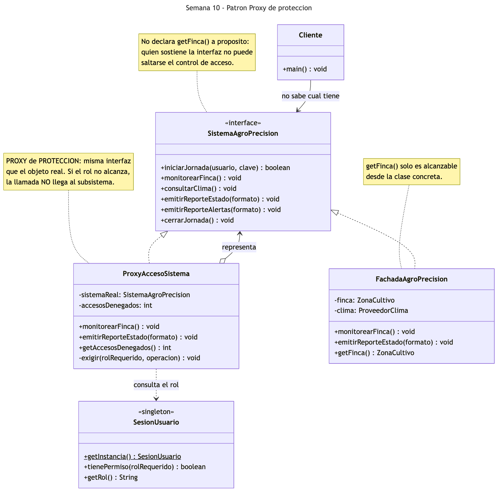
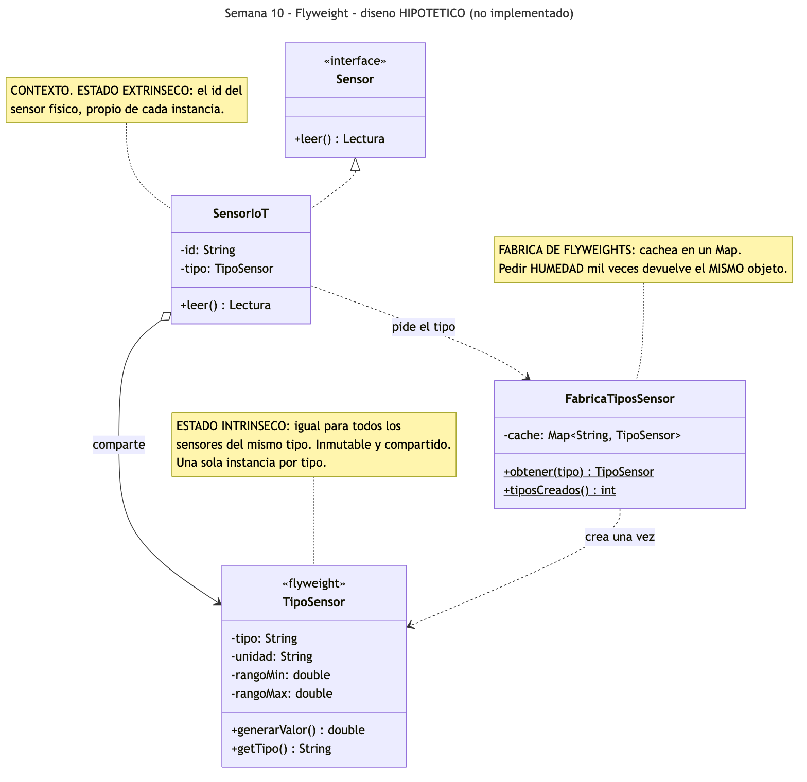
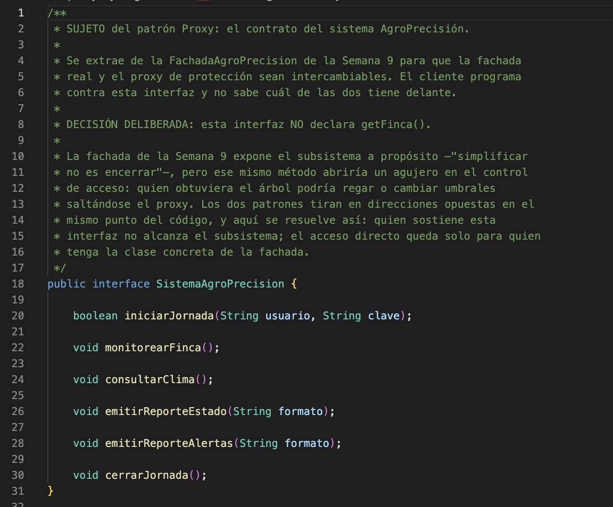
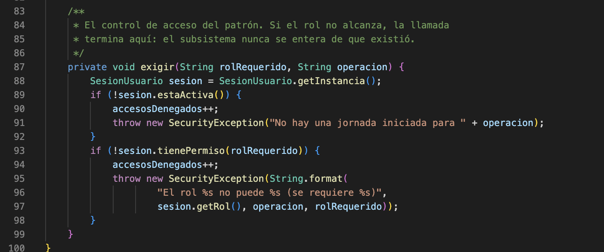
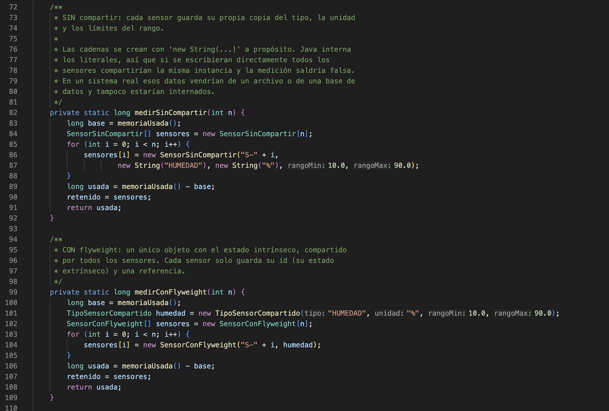
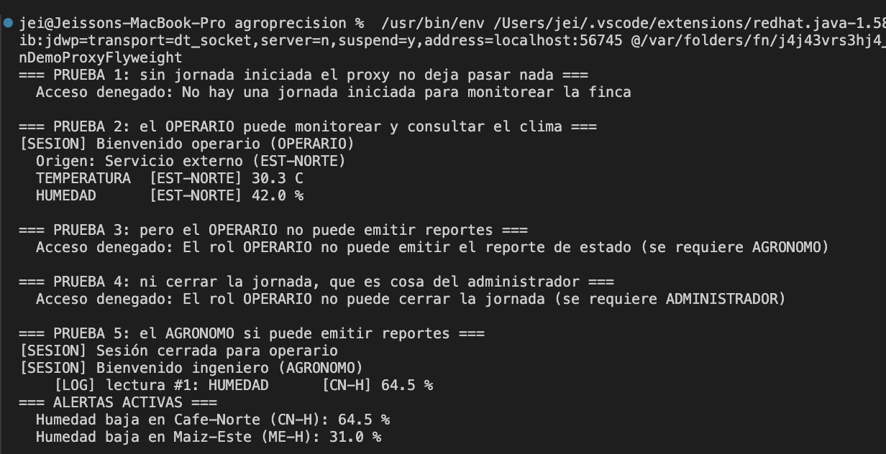
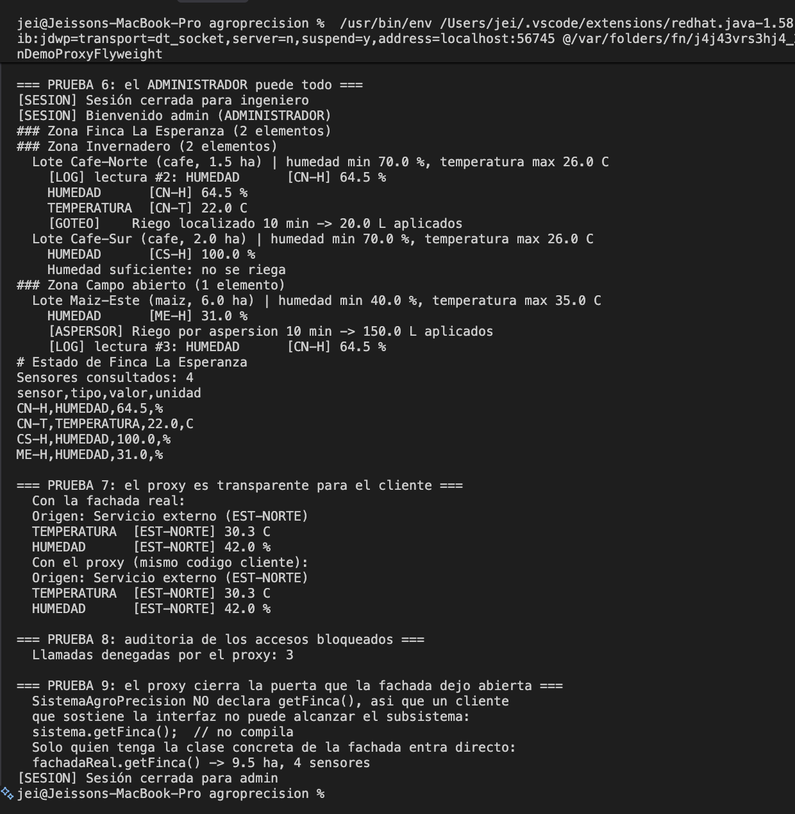
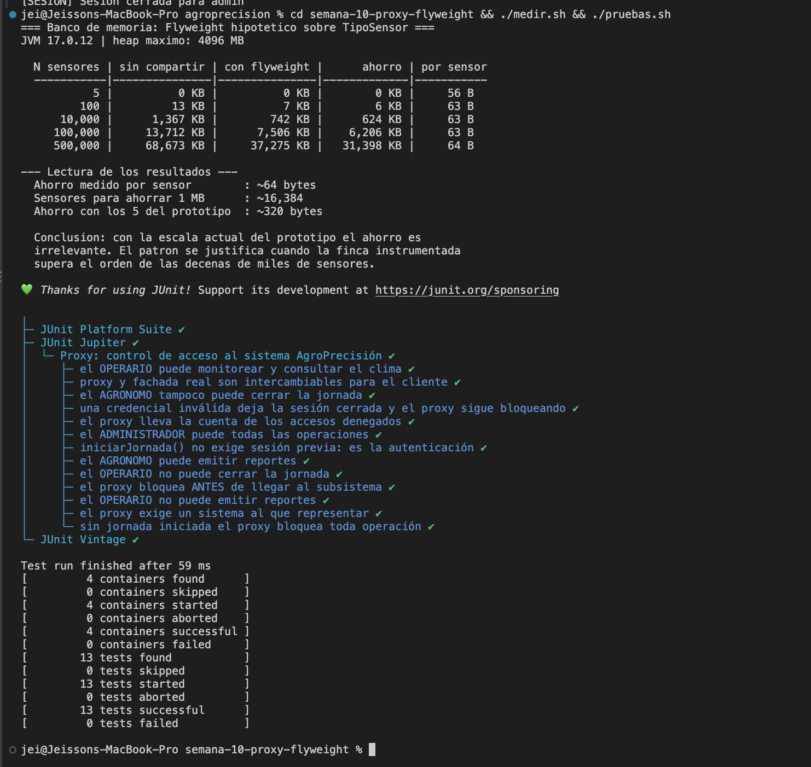

# Semana 10 — Patrones Proxy y Flyweight

Dos patrones estructurales con dos desenlaces distintos. **Proxy** se implementa: un proxy de
protección que controla, según el rol del usuario, qué operaciones del sistema puede ejecutar cada
quien. **Flyweight** **no se implementa**, y esta semana documenta por qué, con una medición que
respalda la decisión y la condición concreta a partir de la cual sí valdría la pena.

**Estudiantes:** Jeisson Stewen Berdugo Cely · Darwin Felipe Gil López
**Grupo:** E-195

Con estos dos se cierra la familia **estructural** del catálogo GoF: Adapter y Bridge (Semana 7),
Composite y Decorator (Semana 8), Facade (Semana 9), y Proxy y Flyweight aquí.

**Código Proxy:** [`SistemaAgroPrecision.java`](src/SistemaAgroPrecision.java) (sujeto) ·
[`ProxyAccesoSistema.java`](src/ProxyAccesoSistema.java) (proxy) ·
[`FachadaAgroPrecision.java`](src/FachadaAgroPrecision.java) (sujeto real)

**Medición del Flyweight:** [`medicion/BancoMemoriaFlyweight.java`](medicion/BancoMemoriaFlyweight.java)

**Demo:** [`MainDemoProxyFlyweight.java`](src/MainDemoProxyFlyweight.java) ·
**Pruebas:** [`ProxyAccesoSistemaTest.java`](test/ProxyAccesoSistemaTest.java)

**Para ejecutar la demo:**

```bash
cd semana-10-proxy-flyweight/src && javac *.java && java MainDemoProxyFlyweight
```

**Para ejecutar las pruebas unitarias:**

```bash
cd semana-10-proxy-flyweight && ./pruebas.sh
```

**Para ejecutar la medición del Flyweight:**

```bash
cd semana-10-proxy-flyweight && ./medir.sh
```

---

## Parte 1 — Proxy de protección

### El problema

`SesionUsuario`, desde la Semana 3, distingue tres roles: `ADMINISTRADOR`, `AGRONOMO` y `OPERARIO`,
y expone un método `tienePermiso(rol)`. Pero hasta ahora **nadie lo usaba**: la fachada de la Semana
9 solo comprobaba que hubiera *alguna* sesión activa. En la práctica, un operario de riego podía
emitir reportes gerenciales y cerrar la jornada.

La salida obvia sería meter la comprobación de rol dentro de cada método de la fachada. Tiene dos
problemas: mezcla el control de acceso con la orquestación del subsistema —dos responsabilidades en
una clase— y obliga a modificar una clase que ya estaba terminada y probada. Si mañana se quiere
una versión sin control de acceso (para pruebas, para un script interno) habría que desactivarlo
con banderas.

### Qué es el Proxy

Es un patrón estructural. Su intención, según el GoF, es proporcionar un sustituto o intermediario
de otro objeto para controlar el acceso a él. Sus roles son el **sujeto** (la interfaz común), el
**sujeto real** (el objeto al que se representa) y el **proxy**. El GoF describe varias variantes
—virtual, remoto, de protección y referencia inteligente—; aquí se usa la **de protección**.

### Cómo lo aplicamos

| Rol en el patrón | Clases |
|---|---|
| Sujeto | [`SistemaAgroPrecision.java`](src/SistemaAgroPrecision.java) — interfaz extraída de la fachada |
| Sujeto real | [`FachadaAgroPrecision.java`](src/FachadaAgroPrecision.java) — la fachada de la Semana 9 |
| Proxy | [`ProxyAccesoSistema.java`](src/ProxyAccesoSistema.java) |
| Cliente | [`MainDemoProxyFlyweight.java`](src/MainDemoProxyFlyweight.java) |

La tabla de permisos que impone el proxy:

| Operación | Rol mínimo |
|---|---|
| `iniciarJornada` | — (es la autenticación: no puede exigir sesión previa) |
| `monitorearFinca`, `consultarClima` | `OPERARIO` |
| `emitirReporteEstado`, `emitirReporteAlertas` | `AGRONOMO` |
| `cerrarJornada` | `ADMINISTRADOR` |

Un detalle que conviene señalar: **no hubo que tocar `SesionUsuario`**. Su `tienePermiso()` ya
concedía todo al `ADMINISTRADOR` (`rol.equals("ADMINISTRADOR") || rol.equals(rolRequerido)`), así
que la jerarquía de roles ya estaba codificada desde la Semana 3 esperando a que alguien la usara.

### Dos distinciones que hay que tener claras

Después de haber hecho Decorator dos veces y Facade una, el Proxy se parece a ambos. La diferencia
no está en la estructura sino en la **intención**:

| | Estructura | Intención |
|---|---|---|
| **Decorator** (S8, S9) | Implementa la interfaz que envuelve | **Añade** comportamiento al resultado. `ClimaConCache` siempre devuelve un dato |
| **Proxy** (S10) | Idéntica: implementa la interfaz que envuelve | **Controla** si la llamada se ejecuta. Puede no devolver nada en absoluto |
| **Facade** (S9) | Interfaz **distinta** y más simple que la del subsistema | **Simplifica** el uso de muchas clases |
| **Proxy** (S10) | **La misma** interfaz del objeto representado | El cliente no nota que está ahí, salvo cuando le niega el paso |

### El conflicto entre el Facade y el Proxy

Este es el hallazgo más interesante de la semana, y no viene de ningún libro: sale del propio
código del proyecto.

La fachada de la Semana 9 expone `getFinca()` **a propósito**, con el argumento de que *"simplificar
no es encerrar"*: quien necesite más de lo que ofrece la fachada debe poder entrar al subsistema.
Pero ese mismo método **abre un agujero en el control de acceso**: un operario que obtuviera el
árbol podría regar o cambiar umbrales saltándose el proxy por completo.

Los dos patrones tiran en direcciones opuestas en el mismo punto del código. La resolución que
adoptamos: **la interfaz `SistemaAgroPrecision` no declara `getFinca()`**. Quien sostiene la
interfaz —y por tanto puede estar hablando con el proxy— no alcanza el subsistema; el acceso directo
queda solo para quien tenga la clase concreta de la fachada. El proxy estrecha deliberadamente la
puerta que la fachada dejó abierta, y la decisión queda documentada en el Javadoc de la interfaz.

### Diagrama UML del Proxy



Proxy y fachada implementan la misma interfaz —por eso son intercambiables para el cliente— y el
proxy además la agrega (`representa`). Esa doble relación es idéntica a la del Decorator; lo que
cambia es qué hace con ella. A la derecha se ve que `getFinca()` cuelga solo de la clase concreta,
fuera del contrato.

Fuente del diagrama: [`diagramas/uml-proxy.mmd`](diagramas/uml-proxy.mmd).

---

## Parte 2 — Flyweight: análisis de no implementación

Esta parte **no implementa el patrón**. Documenta por qué no corresponde hacerlo todavía, qué
diseño se adoptaría si correspondiera, y el umbral concreto a partir del cual sí valdría la pena.

### Qué resuelve el Flyweight

Es un patrón estructural. Su intención, según el GoF, es usar el compartimiento para soportar
eficientemente **grandes cantidades de objetos de grano fino**. Divide el estado de un objeto en
dos:

- **Estado intrínseco**: el que es igual para muchos objetos y no depende del contexto. Se comparte
  en una única instancia inmutable, el *flyweight*.
- **Estado extrínseco**: el que distingue a cada objeto. Lo guarda el contexto, o se pasa como
  parámetro.

La frase clave de su definición es **"grandes cantidades"**. A diferencia de los otros patrones
estructurales, que resuelven problemas de *diseño*, el Flyweight resuelve un problema de
*rendimiento*. Y un problema de rendimiento que no existe no se resuelve: se mide.

### Dónde encajaría en AgroPrecisión

El candidato natural es el **tipo de sensor**. Hoy, cada `SensorHumedad` carga con el tipo
(`"HUMEDAD"`), la unidad (`"%"`) y los límites del rango (10.0 y 90.0). Eso es estado intrínseco
puro: es idéntico en todos los sensores de humedad de la finca. Lo único realmente propio de cada
sensor es su `id`.

| Rol del patrón | Clase que tendría |
|---|---|
| Flyweight | `TipoSensor` — tipo, unidad, rango; inmutable y compartido |
| Fábrica de flyweights | `FabricaTiposSensor` — un `Map` que devuelve siempre la misma instancia por tipo |
| Contexto | `SensorIoT` — su `id` (extrínseco) más una referencia al `TipoSensor` |



Fuente del diagrama: [`diagramas/uml-flyweight-hipotetico.mmd`](diagramas/uml-flyweight-hipotetico.mmd).

### Por qué hoy no se justifica

**Primera razón: Java ya hace parte del trabajo.** En `SensorHumedad`, los límites del rango están
declarados como `private static final double MIN = 10.0`. Una constante `static` pertenece a la
clase, no a la instancia: **ya existe una sola copia compartida por todos los sensores**. Lo mismo
ocurre con los literales de cadena, que la JVM internaliza. Un Flyweight que solo compartiera eso no
aportaría nada sobre lo que el lenguaje ya garantiza. El patrón solo cobra sentido cuando el estado
intrínseco se construye en tiempo de ejecución —leído de un archivo de configuración o de una base
de datos— y por tanto **no** está internado.

**Segunda razón, y la decisiva: a esta escala el ahorro no existe.** No es una opinión; se midió.

### La medición

[`medicion/BancoMemoriaFlyweight.java`](medicion/BancoMemoriaFlyweight.java) construye N sensores de
las dos formas —cada uno con su copia del estado intrínseco, y todos compartiendo un único objeto— y
compara la memoria consumida. Para que la comparación sea honesta, la variante "sin compartir" crea
las cadenas con `new String(...)`: si se usaran literales, la JVM los internaría y todos los
sensores compartirían la misma instancia, falseando el resultado a favor del Flyweight.

```bash
cd semana-10-proxy-flyweight && ./medir.sh
```

Resultado medido en esta máquina (JDK 17):

| N sensores | Sin compartir | Con flyweight | Ahorro | Por sensor |
|---|---|---|---|---|
| 5 | 0 KB | 0 KB | 0 KB | ~56 B |
| 100 | 13 KB | 7 KB | 6 KB | ~63 B |
| 10 000 | 1 367 KB | 742 KB | 624 KB | ~63 B |
| 100 000 | 13 712 KB | 7 506 KB | 6 206 KB | ~63 B |
| 500 000 | 68 673 KB | 37 275 KB | 31 398 KB | ~64 B |

El ahorro es estable: **unos 64 bytes por sensor**. De ahí salen los dos números que sostienen la
decisión:

- Para ahorrar **1 MB** hacen falta unos **16 000 sensores**.
- El prototipo maneja **5 sensores**: el ahorro sería de **unos 320 bytes**. Menos de lo que ocupa
  este párrafo en memoria.

Implementar el patrón ahora costaría tres clases nuevas, una indirección en cada lectura y un
`Map` que consultar, a cambio de 320 bytes. Eso es, con nombre propio, **optimización prematura**.

### La condición bajo la cual sí habría que implementarlo

El patrón entraría al proyecto cuando se cumpla **cualquiera** de estas tres condiciones:

1. **Escala**: la finca instrumentada supera las **decenas de miles de sensores** —del orden de
   16 000, donde el ahorro empieza a medirse en megabytes—. Es un escenario realista si el sistema
   deja de ser un prototipo y gestiona varias fincas con redes IoT densas.
2. **Origen de los datos**: los rangos y unidades dejan de ser constantes de código y pasan a
   leerse de un archivo de configuración o de una base de datos. En ese momento desaparece el
   compartimiento gratuito que da `static final`, y cada sensor sí cargaría con su propia copia.
3. **Catálogo de tipos**: los tipos de sensor dejan de ser tres fijos y se vuelven decenas
   configurables por el usuario, con metadatos más pesados que cuatro campos.

**Qué vigilar para detectarlo:** el número de instancias vivas de `Sensor` y el porcentaje del
*heap* que ocupan. Si en un perfilado el estado intrínseco repetido supera el 10 % de la memoria de
la aplicación, el patrón deja de ser teórico.

Mientras tanto, la decisión de diseño correcta es **no implementarlo**, y dejar documentado el
diseño que se adoptaría —el UML de arriba— para que la implementación futura no parta de cero.

---

## Pruebas unitarias

Trece casos con JUnit 5, todos sobre el Proxy:

```bash
cd semana-10-proxy-flyweight && ./pruebas.sh
```

| Caso | Qué comprueba |
|---|---|
| `sinSesionNoSeOpera` | Sin jornada iniciada, toda operación lanza `SecurityException` |
| `bloqueaAntesDeDelegar` | **El subsistema no recibe la llamada**: el espía registra 0 invocaciones |
| `iniciarJornadaNoExigeSesion` | Autenticarse no puede exigir estar autenticado |
| `operarioMonitorea` | El `OPERARIO` monitorea y consulta el clima |
| `operarioNoReporta` / `operarioNoCierra` | Y no puede reportar ni cerrar; el mensaje dice qué rol hace falta |
| `agronomoReporta` / `agronomoNoCierra` | El `AGRONOMO` reporta pero no cierra |
| `administradorPuedeTodo` | Las cinco operaciones pasan |
| `auditaLosBloqueos` | El contador de accesos denegados |
| `proxyYFachadaSonIntercambiables` | Mismo tipo estático para los dos |
| `noSePuedeRepresentarNada` | El proxy exige un sujeto real |
| `credencialInvalida` | Login fallido deja la sesión cerrada y el proxy sigue bloqueando |

La prueba más importante es `bloqueaAntesDeDelegar`. Usa un doble de prueba, `SistemaEspia`, que
cuenta cuántas llamadas recibió. Que el contador quede en cero demuestra la diferencia de fondo
entre un proxy y un decorador: **el subsistema ni siquiera se entera de que la llamada existió**.

---

## Evidencias

Las tres primeras capturas corresponden al código y las tres últimas a las ejecuciones. La
numeración continúa la de las semanas anteriores.

Todo se ejecutó en VS Code sobre Java 17, con el botón *Run* de la extensión de Java.

| Captura | Qué muestra |
|---|---|
| [43](#captura-43) | `SistemaAgroPrecision`: el sujeto, sin `getFinca()` |
| [44](#captura-44) | `ProxyAccesoSistema`: el método `exigir()`, el control de acceso |
| [45](#captura-45) | `BancoMemoriaFlyweight`: las dos variantes que se comparan |
| [46](#captura-46) | Demo, pruebas 1 a 5: la tabla de permisos en acción |
| [47](#captura-47) | Demo, pruebas 6 a 9: el administrador, la transparencia y la puerta cerrada |
| [48](#captura-48) | La medición del Flyweight y las 13 pruebas en verde |

---

<a id="captura-43"></a>
### Captura 43 — El sujeto del patrón



**Archivo:** `src/SistemaAgroPrecision.java` · **Líneas:** 1 a 31

Las seis operaciones del contrato y, en el Javadoc, la decisión deliberada de **no** declarar
`getFinca()` con su justificación: es donde se resuelve el conflicto entre el Facade y el Proxy.

<a id="captura-44"></a>
### Captura 44 — El control de acceso



**Archivo:** `src/ProxyAccesoSistema.java` · **Líneas:** 85 a 100

`exigir()` es el patrón en seis líneas: comprueba sesión, comprueba rol y lanza `SecurityException`
sin llegar a tocar el sujeto real. El mensaje dice qué rol tiene el usuario y cuál haría falta.

<a id="captura-45"></a>
### Captura 45 — El banco de medición



**Archivo:** `medicion/BancoMemoriaFlyweight.java` · **Líneas:** 72 a 109

Las dos variantes que se comparan. El comentario explica por qué las cadenas se crean con
`new String(...)`: sin eso, la JVM las internaría y la medición saldría falseada.

<a id="captura-46"></a>
### Captura 46 — Demo, la tabla de permisos



**Terminal:** salida de `java MainDemoProxyFlyweight`, pruebas 1 a 5.

Sin sesión no pasa nada; el operario monitorea pero no reporta ni cierra; el agrónomo sí reporta.
Los mensajes de denegación indican el rol que falta.

<a id="captura-47"></a>
### Captura 47 — Demo, transparencia y puerta cerrada



**Terminal:** salida de `java MainDemoProxyFlyweight`, pruebas 6 a 9.

El administrador pasa por todo; el mismo código cliente funciona con la fachada real y con el proxy;
el contador de accesos denegados; y la prueba 9, donde `sistema.getFinca()` ni siquiera compila
porque no está en el contrato.

<a id="captura-48"></a>
### Captura 48 — Medición y pruebas



**Terminal:** salida de `./medir.sh` y de `./pruebas.sh`.

La tabla de memoria con el ahorro estable de ~64 bytes por sensor y las conclusiones numéricas, más
las trece pruebas unitarias del proxy sin fallos.

---

## Resultados

| # | Prueba | Patrón | Resultado esperado | Resultado obtenido | Estado | Captura |
|---|---|---|---|---|---|---|
| 1 | Sin sesión | Proxy | `SecurityException` al monitorear | `No hay una jornada iniciada para monitorear la finca` | ✅ OK | 46 |
| 2 | Operario monitorea | Proxy | Clima consultado sin error | `30.3 C` y `42.0 %` tras `Bienvenido operario (OPERARIO)` | ✅ OK | 46 |
| 3 | Operario sin reportes | Proxy | Denegado, se requiere `AGRONOMO` | `El rol OPERARIO no puede emitir el reporte de estado (se requiere AGRONOMO)` | ✅ OK | 46 |
| 4 | Operario no cierra | Proxy | Denegado, se requiere `ADMINISTRADOR` | `El rol OPERARIO no puede cerrar la jornada (se requiere ADMINISTRADOR)` | ✅ OK | 46 |
| 5 | Agrónomo reporta | Proxy | Reporte de alertas emitido | `ALERTAS ACTIVAS` con Cafe-Norte y Maiz-Este | ✅ OK | 46 |
| 6 | Administrador | Proxy | Monitoreo y reporte CSV sin bloqueos | Cascada por las dos zonas y CSV de 4 sensores | ✅ OK | 47 |
| 7 | Transparencia | Proxy | Mismo código cliente con fachada y con proxy | Salida idéntica con la fachada real y con el proxy | ✅ OK | 47 |
| 8 | Auditoría | Proxy | 3 accesos denegados | `Llamadas denegadas por el proxy: 3` | ✅ OK | 47 |
| 9 | Puerta cerrada | Proxy | `getFinca()` inalcanzable desde la interfaz | `sistema.getFinca(); // no compila` · `fachadaReal.getFinca() -> 9.5 ha, 4 sensores` | ✅ OK | 47 |
| 10 | Medición de memoria | Flyweight | ~64 B por sensor; ~16 000 sensores para 1 MB | `~64 bytes` · `~16,384` sensores para 1 MB · `~320 bytes` con los 5 del prototipo | ✅ OK | 48 |
| 11 | Pruebas unitarias | Proxy | 13 pruebas exitosas, 0 fallidas | `13 tests successful`, `0 tests failed`, en 59 ms | ✅ OK | 48 |
