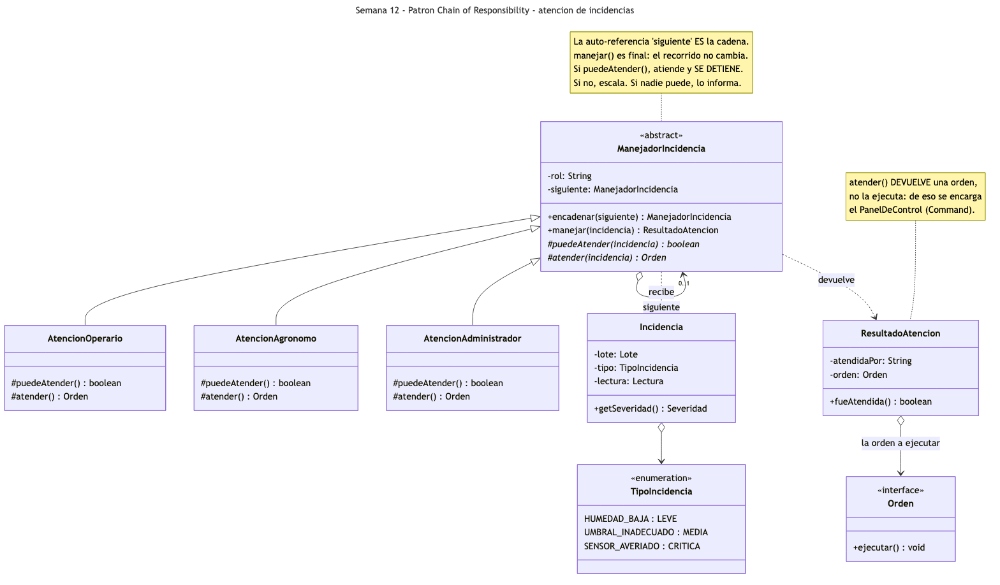
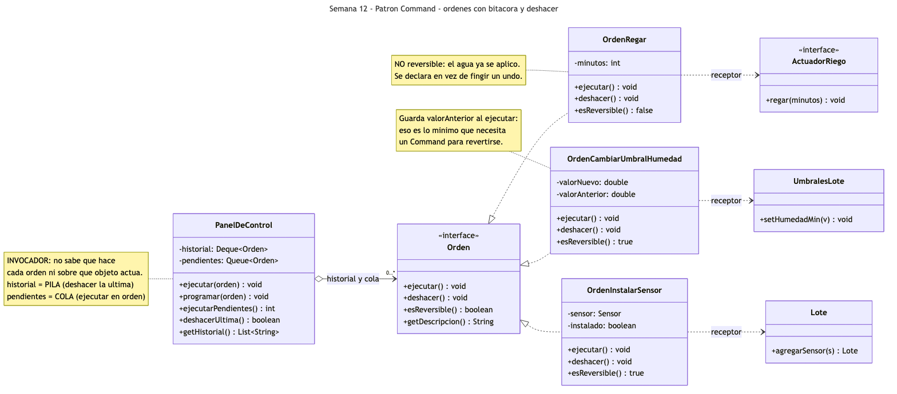
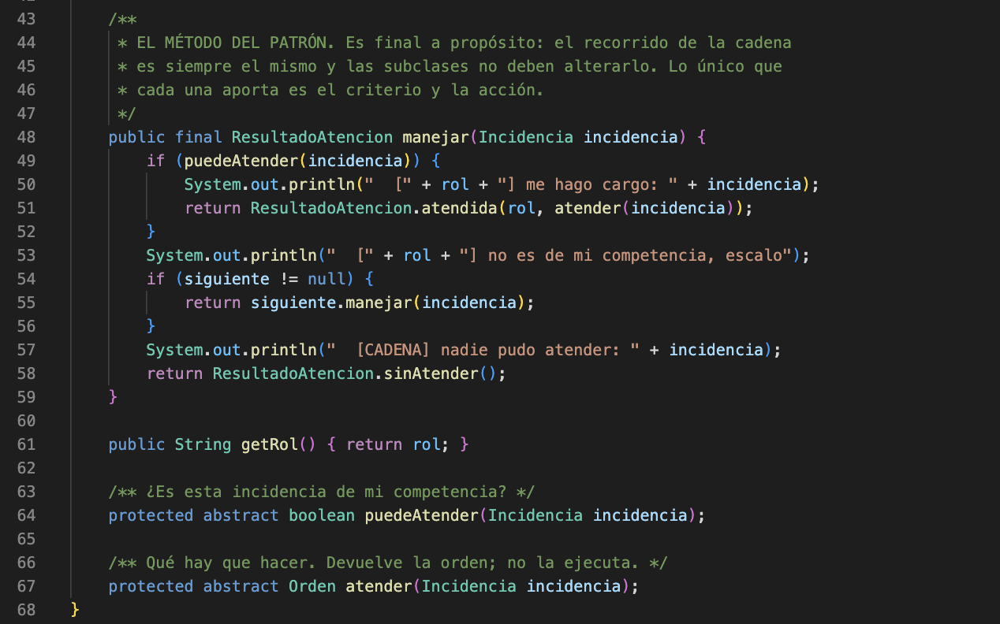
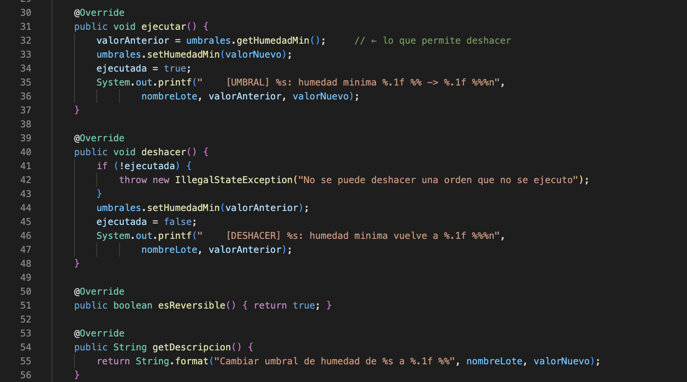
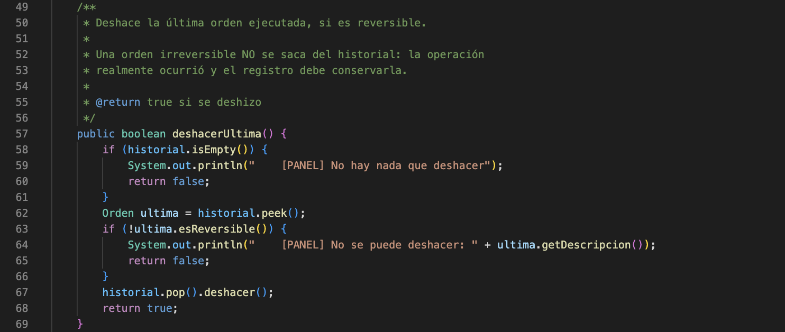
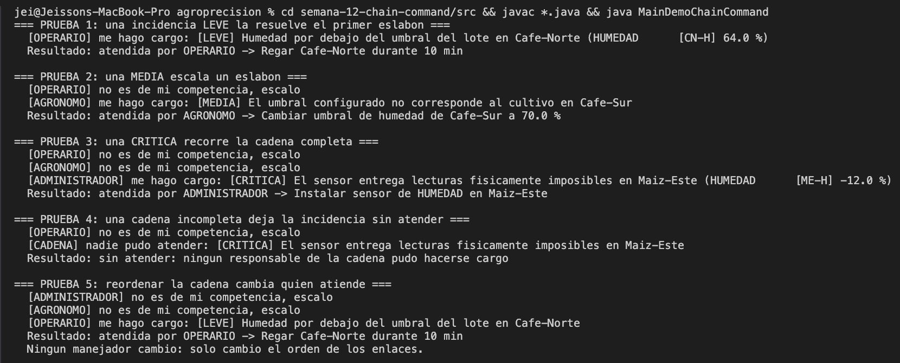
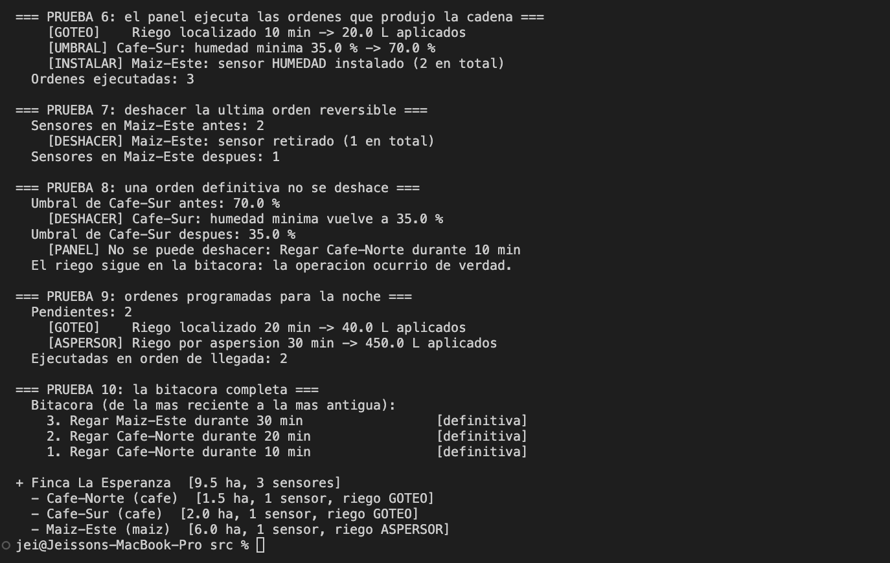
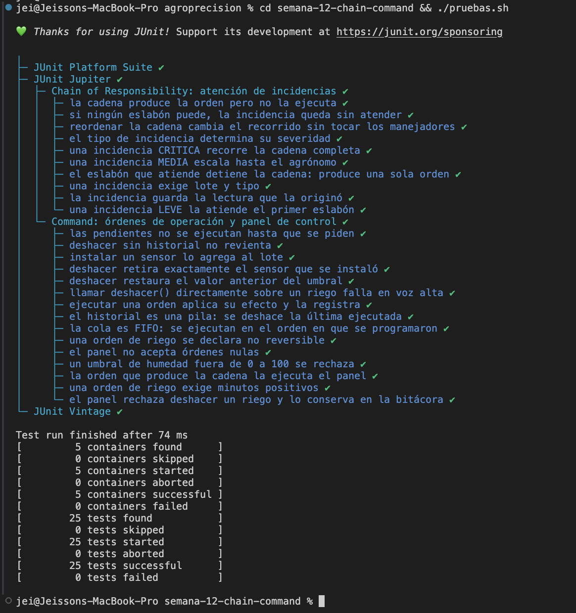

# Semana 12 — Patrones Chain of Responsibility y Command

Dos patrones **de comportamiento**, los primeros del proyecto después de cerrar las familias
creacional y estructural. **Chain of Responsibility** decide *quién se hace cargo* de una
incidencia escalándola por la jerarquía de la finca; **Command** convierte la acción resultante en
un objeto que se puede registrar, encolar y deshacer.

**Estudiantes:** Jeisson Stewen Berdugo Cely · Darwin Felipe Gil López
**Grupo:** E-195

**Código Chain of Responsibility:** [`ManejadorIncidencia.java`](src/ManejadorIncidencia.java) (manejador abstracto) ·
[`AtencionOperario.java`](src/AtencionOperario.java) · [`AtencionAgronomo.java`](src/AtencionAgronomo.java) · [`AtencionAdministrador.java`](src/AtencionAdministrador.java) ·
[`Incidencia.java`](src/Incidencia.java) · [`TipoIncidencia.java`](src/TipoIncidencia.java) · [`Severidad.java`](src/Severidad.java) · [`ResultadoAtencion.java`](src/ResultadoAtencion.java)

**Código Command:** [`Orden.java`](src/Orden.java) (interfaz) ·
[`OrdenRegar.java`](src/OrdenRegar.java) · [`OrdenCambiarUmbralHumedad.java`](src/OrdenCambiarUmbralHumedad.java) · [`OrdenInstalarSensor.java`](src/OrdenInstalarSensor.java) ·
[`PanelDeControl.java`](src/PanelDeControl.java) (invocador)

**Demo:** [`MainDemoChainCommand.java`](src/MainDemoChainCommand.java) ·
**Pruebas:** [`CadenaIncidenciasTest.java`](test/CadenaIncidenciasTest.java) · [`OrdenesPanelTest.java`](test/OrdenesPanelTest.java)

**Para ejecutar la demo:**

```bash
cd semana-12-chain-command/src && javac *.java && java MainDemoChainCommand
```

**Para ejecutar las pruebas unitarias:**

```bash
cd semana-12-chain-command && ./pruebas.sh
```

Las clases de semanas anteriores están copiadas para que esta carpeta compile por sí sola. La única
adaptada es `Lote`: se le **restauró** el getter `getActuador()`, que el original de la Semana 6 sí
tenía y la adaptación de la Semana 8 no necesitaba. Lo exige `OrdenRegar`, porque el receptor de esa
orden es el actuador. La cabecera del archivo lo dice.

---

## Parte 1 — Chain of Responsibility: atención de incidencias

### El problema

Cuando una lectura dispara una incidencia, alguien tiene que hacerse cargo. Pero **no siempre el
mismo**: una humedad baja la resuelve el operario regando; un umbral mal configurado exige criterio
agronómico; un sensor averiado implica gasto y lo aprueba el administrador.

Resuelto con condicionales, el emisor termina sabiendo demasiado:

```java
if (incidencia.getSeveridad() == LEVE)         operario.atender(incidencia);
else if (incidencia.getSeveridad() == MEDIA)   agronomo.atender(incidencia);
else if (incidencia.getSeveridad() == CRITICA) administrador.atender(incidencia);
else                                           /* ¿y si nadie puede? */
```

Ese bloque tiene tres defectos. **Acopla al emisor con todos los responsables**: quien detecta la
incidencia tiene que conocer la jerarquía entera. **Se repite** en cada punto donde se detecte una
incidencia. Y **el orden de escalamiento queda cableado**: cambiarlo obliga a reescribir el `if`.

### Qué es el Chain of Responsibility

Es un patrón de comportamiento. Su intención, según el GoF, es evitar acoplar el emisor de una
petición a su receptor, dando a más de un objeto la oportunidad de atenderla: se encadenan los
receptores y la petición se pasa por la cadena hasta que uno la maneja.

Sus roles son el **manejador** (declara la interfaz y guarda la referencia al siguiente), los
**manejadores concretos** y el **cliente**, que lanza la petición a la cabeza de la cadena.

### Cómo lo aplicamos

| Rol en el patrón | Clases |
|---|---|
| Manejador | [`ManejadorIncidencia.java`](src/ManejadorIncidencia.java) |
| Manejadores concretos | [`AtencionOperario.java`](src/AtencionOperario.java) · [`AtencionAgronomo.java`](src/AtencionAgronomo.java) · [`AtencionAdministrador.java`](src/AtencionAdministrador.java) |
| Petición | [`Incidencia.java`](src/Incidencia.java) — inmutable |
| Desenlace | [`ResultadoAtencion.java`](src/ResultadoAtencion.java) |

La cadena se arma encadenando llamadas, y se conserva la cabeza:

```java
ManejadorIncidencia cadena = new AtencionOperario();
cadena.encadenar(new AtencionAgronomo()).encadenar(new AtencionAdministrador());
```

Cuatro decisiones sostienen la implementación:

- **`manejar()` es `final`.** El recorrido de la cadena —intentar, atender o escalar— es siempre el
  mismo y las subclases no deben alterarlo. Lo único que cada una aporta es `puedeAtender()` y
  `atender()`. Es el esqueleto fijo con pasos variables; dicho de paso, es un **Template Method**
  dentro del manejador.
- **La incidencia es inmutable.** Ningún eslabón puede modificarla antes de pasarla al siguiente.
- **El caso "nadie puede" se resuelve explícitamente.** Si la cadena se agota, `ResultadoAtencion`
  lo dice en vez de devolver `null` o quedarse en silencio. Un escalamiento que se pierde sin dejar
  rastro es un error difícil de encontrar.
- **`atender()` devuelve una orden; no la ejecuta.** La cadena decide *quién* y *qué*, pero no
  actúa. Ese es el enlace con la Parte 2.

### Diagrama UML del Chain of Responsibility



La relación que define el patrón es la **auto-referencia** de `ManejadorIncidencia` hacia sí mismo,
rotulada `siguiente`: eso *es* la cadena. A la derecha se ve que lo que sale de ella no es un
efecto, sino un `ResultadoAtencion` que contiene una `Orden`.

Fuente del diagrama: [`diagramas/uml-chain-of-responsibility.mmd`](diagramas/uml-chain-of-responsibility.mmd).

---

## Parte 2 — Command: órdenes con bitácora y deshacer

### El problema

Las acciones que resuelven una incidencia —regar, ajustar un umbral, instalar un sensor— se
ejecutaban llamando directamente al método correspondiente. Eso funciona, pero **una llamada a un
método no se puede guardar, ni programar para la noche, ni deshacer**, y en una finca las tres cosas
hacen falta: hay que auditar qué se hizo, dejar riegos programados y poder revertir un cambio de
configuración equivocado.

### Qué es el Command

Es un patrón de comportamiento. Su intención, según el GoF, es encapsular una petición como un
objeto, permitiendo parametrizar clientes con distintas peticiones, encolarlas o registrarlas, y
soportar operaciones deshacibles.

Sus roles son el **command** (la interfaz), los **commands concretos**, el **receptor** (quien sabe
hacer el trabajo real), el **invocador** (quien dispara la orden sin saber qué hace) y el **cliente**.

### Cómo lo aplicamos

| Rol en el patrón | Clases |
|---|---|
| Command | [`Orden.java`](src/Orden.java) |
| Commands concretos | [`OrdenRegar.java`](src/OrdenRegar.java) · [`OrdenCambiarUmbralHumedad.java`](src/OrdenCambiarUmbralHumedad.java) · [`OrdenInstalarSensor.java`](src/OrdenInstalarSensor.java) |
| Receptores | `ActuadorRiego` · `UmbralesLote` · `Lote` |
| Invocador | [`PanelDeControl.java`](src/PanelDeControl.java) |

El patrón compra tres cosas, y cada una se ve en una parte distinta del panel:

| Qué compra | Dónde se ve |
|---|---|
| **Parametrizar** | `panel.ejecutar(orden)` recibe cualquier orden sin saber qué hace |
| **Encolar** | `programar()` y `ejecutarPendientes()`, una **cola FIFO** |
| **Deshacer** | `deshacerUltima()` sobre el historial, una **pila LIFO** |

Dos decisiones que conviene defender:

- **El receptor de cada orden es quien sabe hacer el trabajo**, no el objeto más visible. El
  receptor de `OrdenRegar` es el `ActuadorRiego`, no el `Lote`; el de `OrdenCambiarUmbralHumedad`
  es `UmbralesLote`. El UML lo marca con la etiqueta `receptor`.
- **Hay órdenes que no se pueden deshacer, y el patrón no obliga a fingir que sí.** `OrdenRegar`
  declara `esReversible() == false`, su `deshacer()` lanza `UnsupportedOperationException`, y el
  panel la rechaza con un mensaje claro **sin sacarla del historial**: la operación ocurrió de
  verdad y el registro debe conservarla.

Sobre el *undo*: `OrdenCambiarUmbralHumedad` guarda el valor anterior al ejecutarse, que es lo
mínimo que necesita un Command para revertirse. Cuando el estado a restaurar es grande o complejo,
el patrón indicado para capturarlo es **Memento**.

### Diagrama UML del Command



El `PanelDeControl` apunta solo a la interfaz `Orden`: no conoce ninguna orden concreta ni ningún
receptor. Por eso funcionaría igual con órdenes que todavía no existen.

Fuente del diagrama: [`diagramas/uml-command.mmd`](diagramas/uml-command.mmd).

---

## Cómo se combinan los dos patrones

Es la integración más limpia del proyecto hasta ahora, y cabe en una frase:

> **La cadena decide quién se hace cargo y qué hay que hacer; el Command encapsula esa acción; el
> panel la ejecuta, la registra y, si se puede, la deshace.**

```java
ResultadoAtencion resultado = cadena.manejar(incidencia);   // ¿quién? ¿qué?
if (resultado.fueAtendida()) {
    panel.ejecutar(resultado.getOrden());                   // hacerlo, y registrarlo
}
```

La cadena **nunca ejecuta nada**: produce órdenes. Esa separación es lo que permite probarla sin
efectos secundarios —hay una prueba que lo verifica— y lo que deja la puerta abierta a programar la
orden en vez de ejecutarla.

### Dos fronteras que respetamos a propósito

Quedan patrones de comportamiento por implementar, y estos dos podrían invadirlos:

- **Strategy** (riego, pendiente): la *decisión* de cuánto y cómo regar sigue siendo suya.
  `OrdenRegar` recibe los minutos ya calculados; no contiene la regla que los elige.
- **Observer** (alertas, pendiente): es *quién se entera* de una incidencia. La cadena es *quién la
  atiende*. Son dos ejes distintos sobre el mismo módulo.

Es el mismo cuidado que tuvimos en la Semana 6 al separar `ActuadorRiego` —el dispositivo— de la
decisión de regar.

---

## Pruebas unitarias

Veinticinco casos con JUnit 5:

```bash
cd semana-12-chain-command && ./pruebas.sh
```

| Clase | Caso | Qué comprueba |
|---|---|---|
| `CadenaIncidenciasTest` | `leveLaAtiendeElOperario` | La LEVE no pasa del primer eslabón |
| | `mediaEscalaAlAgronomo` / `criticaLlegaAlAdministrador` | El escalamiento por severidad |
| | `soloUnEslabonAtiende` | **La cadena se detiene**: la orden es la del operario, no la de otro |
| | `cadenaIncompleta` | Sin manejador competente, queda sin atender |
| | `reordenarLaCadena` | **Cambiar el orden cambia el recorrido sin tocar un manejador** |
| | `laCadenaNoEjecuta` | Tras manejar, el umbral sigue intacto |
| | `elTipoFijaLaSeveridad` | Tipo y gravedad no pueden contradecirse |
| | `incidenciaInvalida` / `incidenciaConLectura` | Validación e inmutabilidad |
| `OrdenesPanelTest` | `ejecutarRegistra` / `instalarSensor` | El efecto se aplica y queda registrado |
| | `deshacerRestaura` | **El umbral vuelve a su valor anterior** |
| | `deshacerRetiraElSensor` | Retira *ese* sensor, no otro |
| | `historialEsPila` | LIFO: se deshace la última, no la primera |
| | `deshacerSinHistorial` | No revienta |
| | `elRiegoNoEsReversible` · `elPanelRechazaDeshacerElRiego` · `deshacerRiegoDirectamenteFalla` | **Lo irreversible se declara y se conserva en la bitácora** |
| | `programarNoEjecuta` / `colaEsFifo` | La cola respeta el orden de llegada |
| | `riegoConMinutosInvalidos` · `umbralFueraDeRango` · `panelRechazaNulos` | Validaciones |
| | `cadenaYPanelSeComponen` | **Los dos patrones juntos**, de la incidencia al efecto |

Las dos más importantes para sustentar son `soloUnEslabonAtiende` —que distingue la cadena del
Decorator— y `laCadenaNoEjecuta`, que demuestra la separación entre decidir y actuar.

---

## Evidencias

Las tres primeras capturas corresponden al código y las tres últimas a las ejecuciones. La
numeración continúa la de las semanas anteriores.

Todo se ejecutó en VS Code sobre Java 17, con el botón *Run* de la extensión de Java.

| Captura | Qué muestra |
|---|---|
| [49](#captura-49) | `ManejadorIncidencia.manejar()`: el recorrido de la cadena |
| [50](#captura-50) | `OrdenCambiarUmbralHumedad`: cómo se guarda lo necesario para deshacer |
| [51](#captura-51) | `PanelDeControl.deshacerUltima()`: la pila y el rechazo de lo irreversible |
| [52](#captura-52) | Demo, pruebas 1 a 5: el escalamiento |
| [53](#captura-53) | Demo, pruebas 6 a 10: ejecutar, deshacer, programar y la bitácora |
| [54](#captura-54) | Las 25 pruebas unitarias en verde |

---

<a id="captura-49"></a>
### Captura 49 — El recorrido de la cadena



**Archivo:** `src/ManejadorIncidencia.java` · **Líneas:** 43 a 68

`manejar()` es `final`: pregunta `puedeAtender()`, y si la respuesta es sí **atiende y devuelve**,
sin seguir. Si no, delega en el siguiente; si no hay siguiente, lo informa. Doce líneas que son todo
el patrón.

<a id="captura-50"></a>
### Captura 50 — Lo que hace posible deshacer



**Archivo:** `src/OrdenCambiarUmbralHumedad.java` · **Líneas:** 30 a 56

La línea clave es `valorAnterior = umbrales.getHumedadMin()` **antes** de aplicar el cambio. Sin
ese guardado no hay *undo* posible.

<a id="captura-51"></a>
### Captura 51 — El invocador



**Archivo:** `src/PanelDeControl.java` · **Líneas:** 49 a 69

`deshacerUltima()` mira la cima de la pila; si la orden no es reversible **no la saca del
historial**: la operación ocurrió y el registro debe conservarla.

<a id="captura-52"></a>
### Captura 52 — Demo, el escalamiento



**Terminal:** salida de `java MainDemoChainCommand`, pruebas 1 a 5.

Se ve el recorrido eslabón por eslabón: la LEVE se resuelve de inmediato, la MEDIA escala una vez,
la CRÍTICA recorre la cadena entera. La prueba 4 muestra el caso sin manejador y la 5, que
reordenar los enlaces cambia el recorrido.

<a id="captura-53"></a>
### Captura 53 — Demo, las órdenes



**Terminal:** salida de `java MainDemoChainCommand`, pruebas 6 a 10.

El panel ejecuta las tres órdenes que produjo la cadena, deshace las dos reversibles, rechaza
deshacer el riego, ejecuta las programadas en orden de llegada e imprime la bitácora.

<a id="captura-54"></a>
### Captura 54 — Las pruebas unitarias



**Terminal:** salida de `./pruebas.sh`.

Veinticinco pruebas, ninguna fallida.

---

## Resultados

| # | Prueba | Patrón | Resultado esperado | Resultado obtenido | Estado | Captura |
|---|---|---|---|---|---|---|
| 1 | Incidencia LEVE | Chain | La atiende el `OPERARIO` sin escalar | `[OPERARIO] me hago cargo` → `Regar Cafe-Norte durante 10 min` | ✅ OK | 52 |
| 2 | Incidencia MEDIA | Chain | Escala un eslabón hasta el `AGRONOMO` | El operario escala; `[AGRONOMO] me hago cargo` → cambiar umbral a 70.0 % | ✅ OK | 52 |
| 3 | Incidencia CRÍTICA | Chain | Recorre los tres y la atiende el `ADMINISTRADOR` | Dos escalamientos y `[ADMINISTRADOR] me hago cargo` → instalar sensor | ✅ OK | 52 |
| 4 | Cadena incompleta | Chain | Queda sin atender, y se informa | `[CADENA] nadie pudo atender` · `sin atender: ningun responsable...` | ✅ OK | 52 |
| 5 | Cadena reordenada | Chain | Cambia el recorrido sin tocar los manejadores | Administrador y agrónomo escalan; la atiende el operario, ahora el último | ✅ OK | 52 |
| 6 | Ejecutar las órdenes | Command | Riego, cambio de umbral e instalación aplicados | `20.0 L aplicados` · `35.0 % -> 70.0 %` · `2 en total` · `Ordenes ejecutadas: 3` | ✅ OK | 53 |
| 7 | Deshacer reversible | Command | El sensor instalado se retira | Sensores en Maiz-Este: `2` → `1` | ✅ OK | 53 |
| 8 | Rechazar lo definitivo | Command | El umbral se restaura; el riego no se deshace | Umbral `70.0 %` → `35.0 %`; `[PANEL] No se puede deshacer: Regar Cafe-Norte...` | ✅ OK | 53 |
| 9 | Órdenes programadas | Command | Dos pendientes ejecutadas en orden de llegada | `Pendientes: 2` → goteo 20 min y aspersor 30 min · `Ejecutadas: 2` | ✅ OK | 53 |
| 10 | Bitácora | Command | Tres riegos, todos marcados como definitivos | Tres entradas, de la más reciente a la más antigua, todas `[definitiva]` | ✅ OK | 53 |
| 11 | Pruebas unitarias | Ambos | 25 pruebas exitosas, 0 fallidas | `25 tests successful`, `0 tests failed`, en 74 ms | ✅ OK | 54 |
