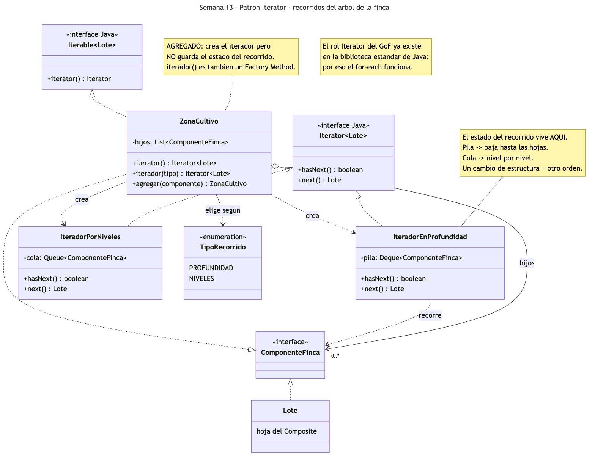
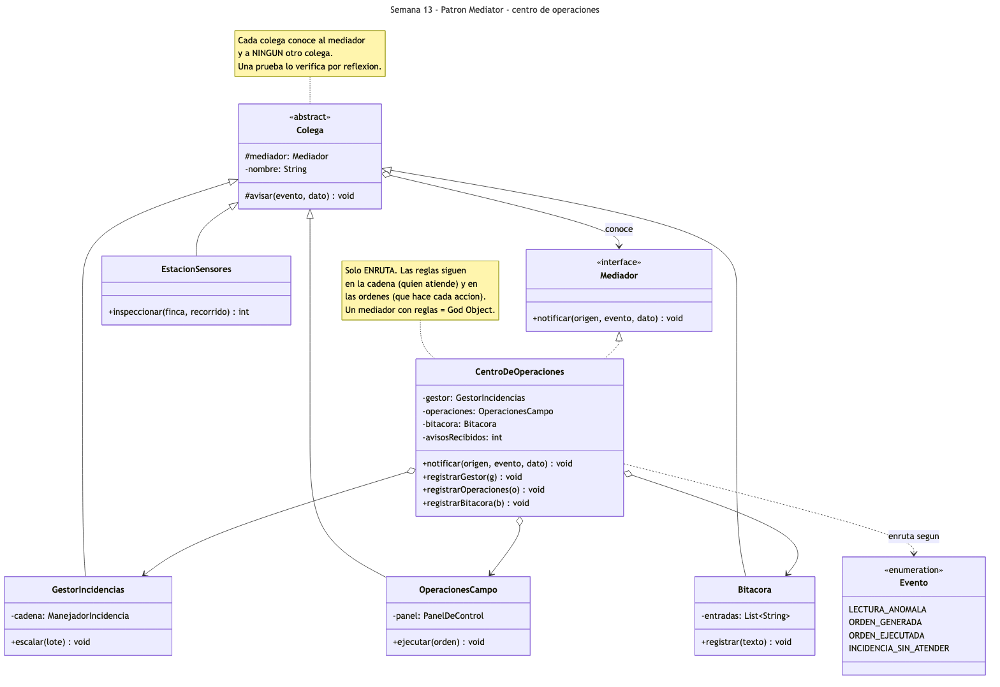
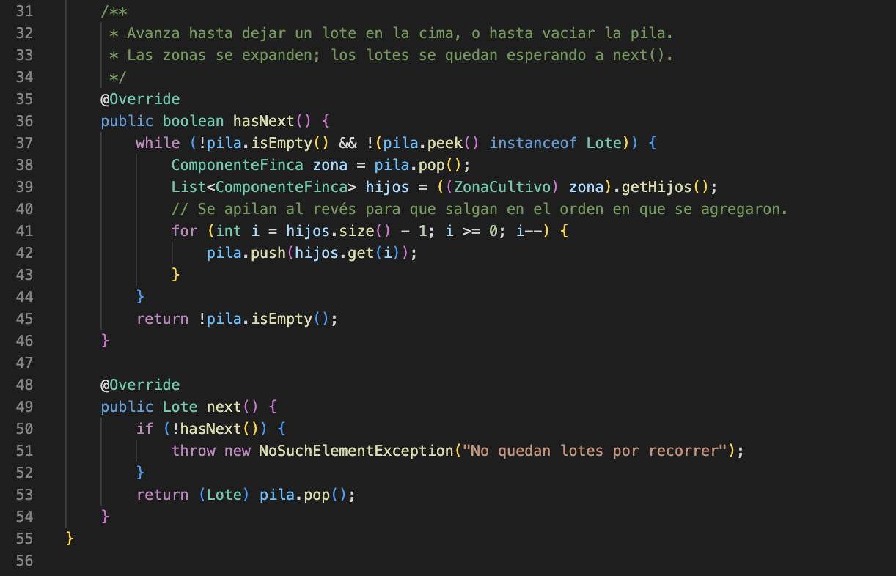
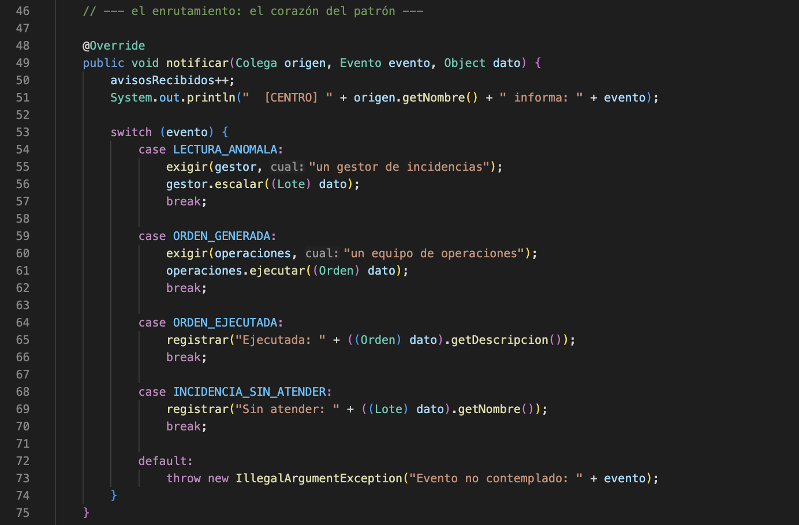
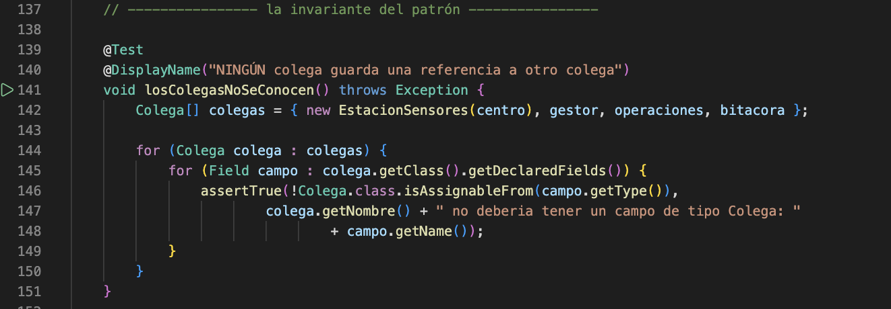
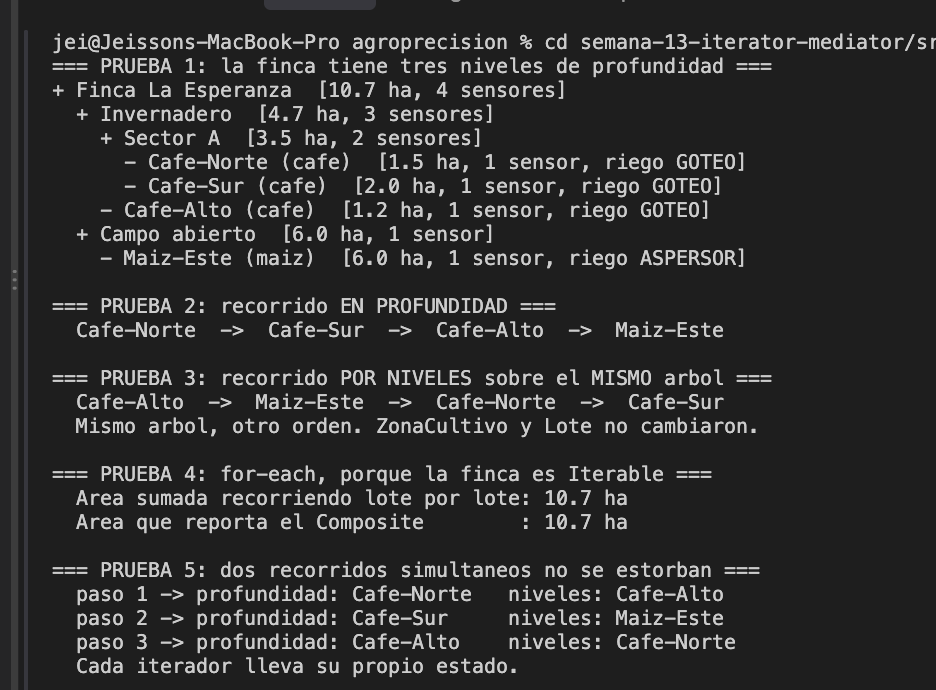
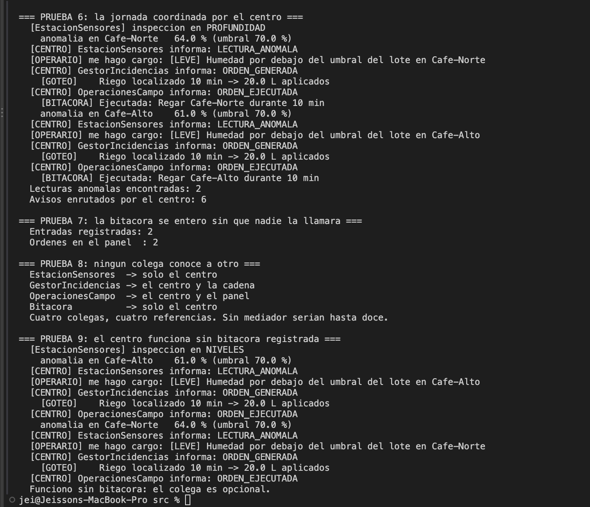
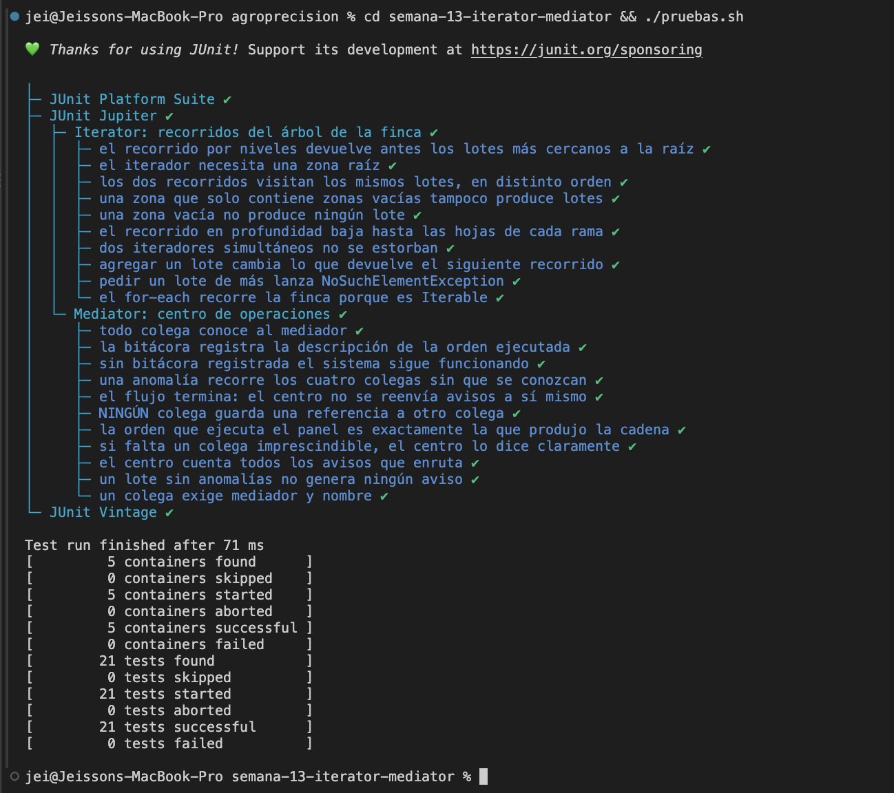

# Semana 13 — Patrones Iterator y Mediator

Dos patrones **de comportamiento** que se apoyan entre sí. **Iterator** separa el recorrido del
árbol de la finca de la estructura que lo guarda, con dos órdenes distintos sobre el mismo árbol.
**Mediator** coordina a cuatro colegas que no se conocen entre sí: cada uno habla solo con el centro
de operaciones.

**Estudiantes:** Jeisson Stewen Berdugo Cely · Darwin Felipe Gil López
**Grupo:** E-195

**Código Iterator:** [`ZonaCultivo.java`](src/ZonaCultivo.java) (agregado) ·
[`IteradorEnProfundidad.java`](src/IteradorEnProfundidad.java) · [`IteradorPorNiveles.java`](src/IteradorPorNiveles.java) ·
[`TipoRecorrido.java`](src/TipoRecorrido.java)

**Código Mediator:** [`Mediador.java`](src/Mediador.java) · [`CentroDeOperaciones.java`](src/CentroDeOperaciones.java) ·
[`Colega.java`](src/Colega.java) · [`EstacionSensores.java`](src/EstacionSensores.java) ·
[`GestorIncidencias.java`](src/GestorIncidencias.java) · [`OperacionesCampo.java`](src/OperacionesCampo.java) ·
[`Bitacora.java`](src/Bitacora.java) · [`Evento.java`](src/Evento.java)

**Demo:** [`MainDemoIteratorMediator.java`](src/MainDemoIteratorMediator.java) ·
**Pruebas:** [`RecorridoFincaTest.java`](test/RecorridoFincaTest.java) · [`CentroDeOperacionesTest.java`](test/CentroDeOperacionesTest.java)

**Para ejecutar la demo:**

```bash
cd semana-13-iterator-mediator/src && javac *.java && java MainDemoIteratorMediator
```

**Para ejecutar las pruebas unitarias:**

```bash
cd semana-13-iterator-mediator && ./pruebas.sh
```

Las clases de semanas anteriores están copiadas para que esta carpeta compile por sí sola —incluidas
la cadena de incidencias y las órdenes de la Semana 12—. La única adaptada es `ZonaCultivo`: declara
`implements Iterable<Lote>` y gana `iterator()` e `iterador(TipoRecorrido)`. Su cabecera lo dice.

---

## Parte 1 — Iterator: recorrer el árbol de la finca

### El problema

Desde la Semana 8 la finca es un árbol: zonas que contienen zonas que contienen lotes. Para operar
sobre todos los lotes —inspeccionarlos, sumar áreas, buscar los que están secos— hay que recorrerlo.

Hoy el recorrido está **dentro** de la estructura. `ZonaCultivo.monitorear()` lo hace así:

```java
public void monitorear() {
    for (ComponenteFinca hijo : hijos) hijo.monitorear();
}
```

Eso funciona, pero tiene un límite claro: **el recorrido lo decide la estructura, y es siempre el
mismo**. Si un cliente quiere los lotes en otro orden —primero los más accesibles, por ejemplo— no
puede: tendría que escribir su propia recursión, lo que exige conocer que la finca es un árbol y
que los hijos están en una lista. La estructura interna se filtra hacia afuera.

### Qué es el Iterator

Es un patrón de comportamiento. Su intención, según el GoF, es proporcionar una forma de acceder
secuencialmente a los elementos de un agregado **sin exponer su representación interna**.

Sus roles son el **iterador** (define `hasNext()` y `next()`), los **iteradores concretos**, el
**agregado** (crea el iterador) y el **agregado concreto**.

El GoF distingue además dos formas:

| | Quién controla el recorrido |
|---|---|
| **Iterador interno** | El agregado. El cliente solo pasa qué hacer con cada elemento |
| **Iterador externo** | El **cliente**, con `hasNext()` y `next()` |

> Nuestro `monitorear()` de la Semana 8 **ya es un iterador interno**. Esta semana agrega el
> externo, que es el que el GoF describe como patrón.

### Cómo lo aplicamos

| Rol en el patrón | Clases |
|---|---|
| Iterador | `java.util.Iterator<Lote>` — el rol **ya existe en la biblioteca estándar** |
| Iteradores concretos | [`IteradorEnProfundidad.java`](src/IteradorEnProfundidad.java) · [`IteradorPorNiveles.java`](src/IteradorPorNiveles.java) |
| Agregado | `java.lang.Iterable<Lote>` |
| Agregado concreto | [`ZonaCultivo.java`](src/ZonaCultivo.java) |

Reutilizar `Iterator` e `Iterable` del JDK no es un atajo: es el reconocimiento de que **el patrón
está tan asentado que el lenguaje lo incorporó**. Y tiene una consecuencia muy visible:

```java
for (Lote lote : finca) {        // funciona porque ZonaCultivo es Iterable
    ...
}
```

**Los dos recorridos difieren en una sola decisión**: dónde se guarda lo que falta por visitar.

| Iterador | Estructura | Orden sobre nuestra finca |
|---|---|---|
| `IteradorEnProfundidad` | **Pila** | Cafe-Norte → Cafe-Sur → Cafe-Alto → Maiz-Este |
| `IteradorPorNiveles` | **Cola** | Cafe-Alto → Maiz-Este → Cafe-Norte → Cafe-Sur |

Cambiar una pila por una cola cambia el orden entero, y **ni `ZonaCultivo` ni `Lote` se enteran**.
Esa es la prueba de que el recorrido quedó fuera de la estructura.

Tres decisiones de diseño:

- **El estado del recorrido vive en el iterador**, no en el agregado. Por eso pueden existir varios
  recorridos simultáneos sobre el mismo árbol sin estorbarse, y hay una prueba que lo verifica.
- **`iterador(TipoRecorrido)` es también un Factory Method** —el de la Semana 4—: el cliente pide un
  recorrido y recibe un `Iterator`, sin conocer la clase concreta.
- **El árbol de la demo tiene tres niveles a propósito.** Con un árbol plano los dos recorridos
  darían el mismo orden y la diferencia no se vería.

### Diagrama UML del Iterator



`ZonaCultivo` crea los iteradores pero no guarda el estado del recorrido; ese estado —la pila o la
cola— está dentro de cada iterador concreto. Arriba se ven las dos interfaces de Java que ocupan los
roles del patrón.

Fuente del diagrama: [`diagramas/uml-iterator.mmd`](diagramas/uml-iterator.mmd).

---

## Parte 2 — Mediator: el centro de operaciones

### El problema

Una jornada de inspección encadena cuatro responsabilidades: detectar la anomalía, escalarla como
incidencia, ejecutar la orden que resulte y dejar constancia.

Si cada parte llama directamente a la siguiente, aparece una telaraña:

```java
class EstacionSensores  { private GestorIncidencias gestor;  }   // la estación conoce al gestor
class GestorIncidencias { private OperacionesCampo operaciones; } // el gestor conoce a operaciones
class OperacionesCampo  { private Bitacora bitacora;         }   // operaciones conoce la bitácora
```

Con cuatro objetos eso son hasta **doce referencias cruzadas**, y cada objeto nuevo las multiplica.
Peor: reordenar el flujo —que la bitácora registre también las incidencias sin atender, por
ejemplo— obliga a modificar varias clases que no tienen nada que ver con el cambio.

### Qué es el Mediator

Es un patrón de comportamiento. Su intención, según el GoF, es definir un objeto que encapsule cómo
interactúa un conjunto de objetos, favoreciendo el bajo acoplamiento al evitar que se refieran unos
a otros explícitamente.

Sus roles son el **mediador**, el **mediador concreto** y los **colegas**.

### Cómo lo aplicamos

| Rol en el patrón | Clases |
|---|---|
| Mediador | [`Mediador.java`](src/Mediador.java) |
| Mediador concreto | [`CentroDeOperaciones.java`](src/CentroDeOperaciones.java) |
| Colega | [`Colega.java`](src/Colega.java) |
| Colegas concretos | [`EstacionSensores.java`](src/EstacionSensores.java) · [`GestorIncidencias.java`](src/GestorIncidencias.java) · [`OperacionesCampo.java`](src/OperacionesCampo.java) · [`Bitacora.java`](src/Bitacora.java) |

El flujo completo, y nadie llama a nadie directamente:

| Quién avisa | Qué informa | A quién pone a trabajar el centro |
|---|---|---|
| `EstacionSensores` | `LECTURA_ANOMALA` | `GestorIncidencias` |
| `GestorIncidencias` | `ORDEN_GENERADA` | `OperacionesCampo` |
| `OperacionesCampo` | `ORDEN_EJECUTADA` | `Bitacora` |
| `GestorIncidencias` | `INCIDENCIA_SIN_ATENDER` | `Bitacora` |

Tres decisiones que conviene defender:

- **Los eventos son hechos, no órdenes.** Un colega informa de lo que pasó (`ORDEN_EJECUTADA`), no
  de lo que hay que hacer. Quien decide qué sigue es el mediador. Si los colegas dijeran
  "registra esto", volverían a saber quién hay del otro lado.
- **El centro solo enruta.** Las reglas siguen donde estaban: quién atiende una incidencia lo decide
  la cadena de la Semana 12, y qué hace cada acción lo decide la orden. Un mediador que empieza a
  acumular reglas se convierte en un **God Object**, que es el riesgo conocido del patrón.
- **La bitácora es opcional.** Si no hay ninguna registrada, el sistema funciona igual sin dejar
  constancia. Eso es lo que permite agregar o quitar un colega sin tocar a los demás — y la bitácora
  se agregó al final sin modificar una línea de los otros tres.

Un detalle honesto sobre la firma: el `dato` del aviso viaja como `Object` porque cada evento lleva
una carga distinta —un lote, una orden—. Es el precio de tener una sola puerta de entrada, y queda
acotado a un único `switch` dentro del centro.

### Diagrama UML del Mediator



Todas las flechas de los colegas apuntan al mediador y **ninguna apunta a otro colega**. Esa
ausencia es el patrón: lo que hay que mirar en este diagrama es lo que no está dibujado.

Fuente del diagrama: [`diagramas/uml-mediator.mmd`](diagramas/uml-mediator.mmd).

### La frontera con Facade y con Observer

Tenemos ya una **fachada** (Semana 9), y las dos centralizan. La diferencia hay que poder decirla:

| | Facade | Mediator |
|---|---|---|
| Dirección | **Unidireccional**: de fuera hacia dentro | **Bidireccional**: los colegas hablan por él |
| ¿El subsistema lo conoce? | **No.** La fachada existe para un cliente externo | **Sí.** Cada colega guarda una referencia |
| Para qué | **Simplificar** el acceso | **Reducir el acoplamiento** entre iguales |

Y queda reservado **Observer** (pendiente): es *quién se entera* de un evento, con suscriptores que
el emisor no conoce. Mediator es *cómo se coordinan* colegas que sí conocen al mediador.

---

## Cómo se combinan los dos patrones

`EstacionSensores.inspeccionar()` es donde se encuentran:

```java
Iterator<Lote> lotes = finca.iterador(recorrido);   // ITERATOR
while (lotes.hasNext()) {
    Lote lote = lotes.next();
    if (tieneLecturaAnomala(lote)) {
        avisar(Evento.LECTURA_ANOMALA, lote);        // MEDIATOR
    }
}
```

La estación **recorre la finca sin saber cómo está organizada** y **avisa sin saber quién atenderá**.
Las dos ignorancias son deliberadas, y cada una la compra un patrón distinto.

---

## Pruebas unitarias

Veintiún casos con JUnit 5:

```bash
cd semana-13-iterator-mediator && ./pruebas.sh
```

| Clase | Caso | Qué comprueba |
|---|---|---|
| `RecorridoFincaTest` | `recorridoEnProfundidad` / `recorridoPorNiveles` | El orden exacto de cada recorrido |
| | `mismosLotesDistintoOrden` | **Los mismos cuatro lotes, en orden distinto** |
| | `iteradoresIndependientes` | **Dos recorridos simultáneos no se estorban** |
| | `forEachFunciona` | El `for-each` recorre y suma lo mismo que el Composite |
| | `zonaVacia` / `zonasAnidadasVacias` | Un árbol sin hojas no produce nada |
| | `seAgotaElRecorrido` | `NoSuchElementException` al pedir de más |
| | `elRecorridoReflejaElArbol` | Agregar un lote cambia el siguiente recorrido |
| | `iteradorSinRaiz` | Validación |
| `CentroDeOperacionesTest` | `flujoCompleto` | Tres avisos, una orden ejecutada, una entrada en bitácora |
| | `sinAnomaliasNoHayAvisos` | Un lote sano no dispara nada |
| | `laBitacoraRegistraLaOrden` / `laOrdenViajaIntactaPorElCentro` | La orden llega sin alterarse |
| | `laBitacoraEsOpcional` | **Quitar un colega no rompe a los demás** |
| | `faltaUnColegaImprescindible` | Mensaje claro si falta el gestor |
| | `losColegasNoSeConocen` | **Por reflexión: ningún colega tiene un campo de tipo `Colega`** |
| | `todoColegaConoceAlMediador` | La referencia al mediador existe y es `final` |
| | `elFlujoTermina` | El centro no se reenvía avisos a sí mismo |
| | `elCentroCuentaLosAvisos` | Dos lotes secos → seis avisos |
| | `colegaInvalido` | Validación |

La más interesante es `losColegasNoSeConocen`: recorre por **reflexión** los campos de cada colega y
falla si alguno es de tipo `Colega`. No comprueba un comportamiento, comprueba **la invariante
estructural que define el patrón** — si alguien en el futuro agrega un atajo entre dos colegas, la
prueba se rompe.

---

## Evidencias

Las tres primeras capturas corresponden al código y las tres últimas a las ejecuciones. La
numeración continúa la de las semanas anteriores.

Todo se ejecutó en VS Code sobre Java 17, con el botón *Run* de la extensión de Java.

| Captura | Qué muestra |
|---|---|
| [55](#captura-55) | `IteradorEnProfundidad`: el estado del recorrido en una pila |
| [56](#captura-56) | `CentroDeOperaciones.notificar()`: el enrutamiento |
| [57](#captura-57) | La prueba por reflexión de que los colegas no se conocen |
| [58](#captura-58) | Demo, pruebas 1 a 5: los dos recorridos sobre el mismo árbol |
| [59](#captura-59) | Demo, pruebas 6 a 9: la jornada coordinada por el centro |
| [60](#captura-60) | Las 21 pruebas unitarias en verde |

---

<a id="captura-55"></a>
### Captura 55 — El iterador en profundidad



**Archivo:** `src/IteradorEnProfundidad.java` · **Líneas:** 31 a 55

`hasNext()` expande zonas hasta dejar un lote en la cima de la pila. Los hijos se apilan al revés
para que salgan en el orden en que se agregaron. Toda la memoria del recorrido está en esa pila: por
eso dos iteradores no se estorban.

<a id="captura-56"></a>
### Captura 56 — El enrutamiento del mediador



**Archivo:** `src/CentroDeOperaciones.java` · **Líneas:** 46 a 75

Un `switch` sobre el evento y, en cada rama, el colega al que le toca. Es el único punto del sistema
donde se sabe qué sigue después de qué.

<a id="captura-57"></a>
### Captura 57 — La invariante del patrón, verificada



**Archivo:** `test/CentroDeOperacionesTest.java` · **Líneas:** 139 a 151

La prueba recorre por reflexión los campos de cada colega y falla si alguno es de tipo `Colega`. No
prueba un comportamiento: protege la regla de diseño que define el patrón.

<a id="captura-58"></a>
### Captura 58 — Demo, los recorridos



**Terminal:** salida de `java MainDemoIteratorMediator`, pruebas 1 a 5.

El árbol de tres niveles, los dos órdenes distintos sobre él, el `for-each` dando el mismo total que
el Composite, y dos iteradores avanzando en paralelo sin interferirse.

<a id="captura-59"></a>
### Captura 59 — Demo, la coordinación



**Terminal:** salida de `java MainDemoIteratorMediator`, pruebas 6 a 9.

Se lee el flujo completo: la estación avisa, el centro manda escalar, la cadena atiende, el centro
manda ejecutar, operaciones ejecuta y el centro manda registrar. La prueba 9 corre el mismo flujo
sin bitácora registrada.

<a id="captura-60"></a>
### Captura 60 — Las pruebas unitarias



**Terminal:** salida de `./pruebas.sh`.

Veintiún pruebas, ninguna fallida.

---

## Resultados

| # | Prueba | Patrón | Resultado esperado | Resultado obtenido | Estado | Captura |
|---|---|---|---|---|---|---|
| 1 | El árbol de tres niveles | Iterator | Finca → zonas → subzona → lotes | `10.7 ha, 4 sensores` en la raíz; `Sector A` anidado en `Invernadero` | ✅ OK | 58 |
| 2 | Recorrido en profundidad | Iterator | Cafe-Norte, Cafe-Sur, Cafe-Alto, Maiz-Este | Exactamente ese orden | ✅ OK | 58 |
| 3 | Recorrido por niveles | Iterator | Cafe-Alto, Maiz-Este, Cafe-Norte, Cafe-Sur | Exactamente ese orden, sobre el mismo árbol | ✅ OK | 58 |
| 4 | `for-each` | Iterator | La suma coincide con la del Composite | `10.7 ha` lote por lote · `10.7 ha` según el Composite | ✅ OK | 58 |
| 5 | Recorridos simultáneos | Iterator | Cada iterador avanza por su cuenta | Paso a paso: `Cafe-Norte`/`Cafe-Alto`, `Cafe-Sur`/`Maiz-Este`, `Cafe-Alto`/`Cafe-Norte` | ✅ OK | 58 |
| 6 | Jornada coordinada | Mediator | 2 anomalías, 6 avisos enrutados | `Lecturas anomalas: 2` · `Avisos enrutados: 6`, con el flujo completo visible | ✅ OK | 59 |
| 7 | La bitácora se entera sola | Mediator | 2 entradas, 2 órdenes en el panel | `Entradas registradas: 2` · `Ordenes en el panel: 2` | ✅ OK | 59 |
| 8 | Nadie conoce a nadie | Mediator | Cuatro colegas, cuatro referencias | Las cuatro líneas de dependencias, todas hacia el centro | ✅ OK | 59 |
| 9 | Sin bitácora registrada | Mediator | El flujo sigue funcionando | Dos riegos ejecutados sin una sola línea `[BITACORA]` | ✅ OK | 59 |
| 10 | Pruebas unitarias | Ambos | 21 pruebas exitosas, 0 fallidas | `21 tests successful`, `0 tests failed`, en 71 ms | ✅ OK | 60 |
