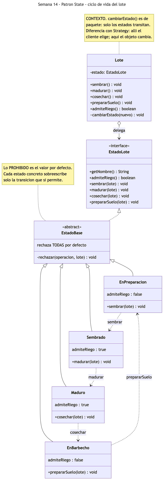
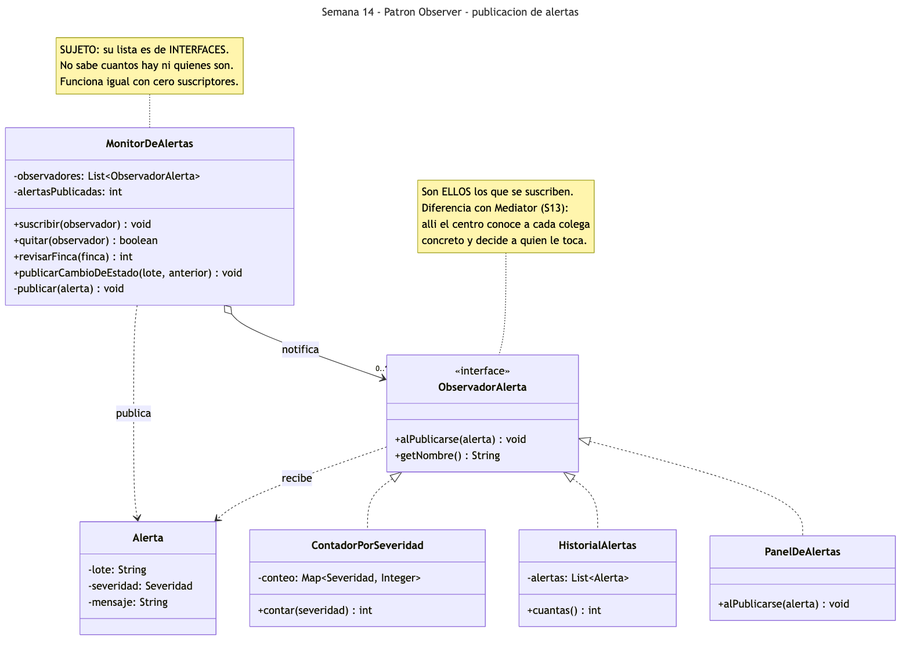
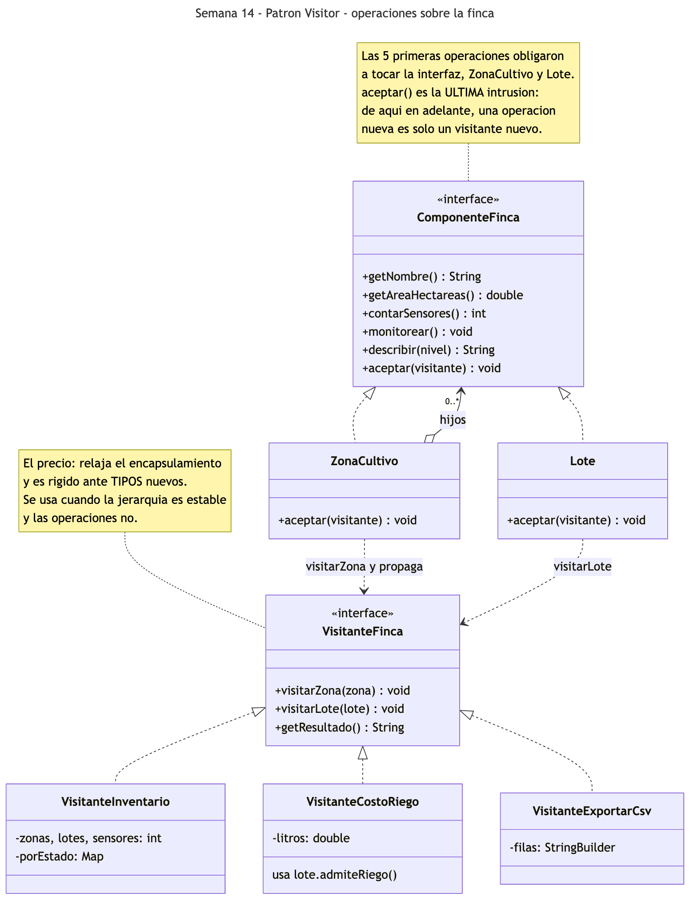
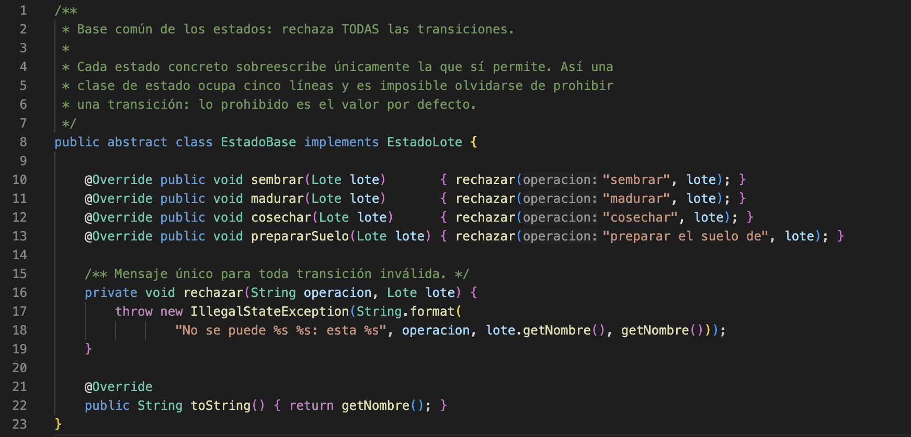
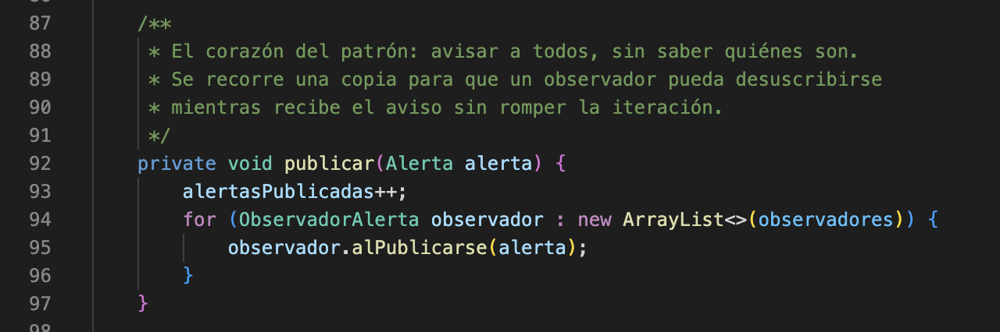
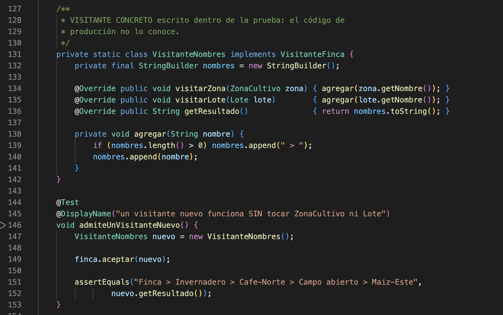
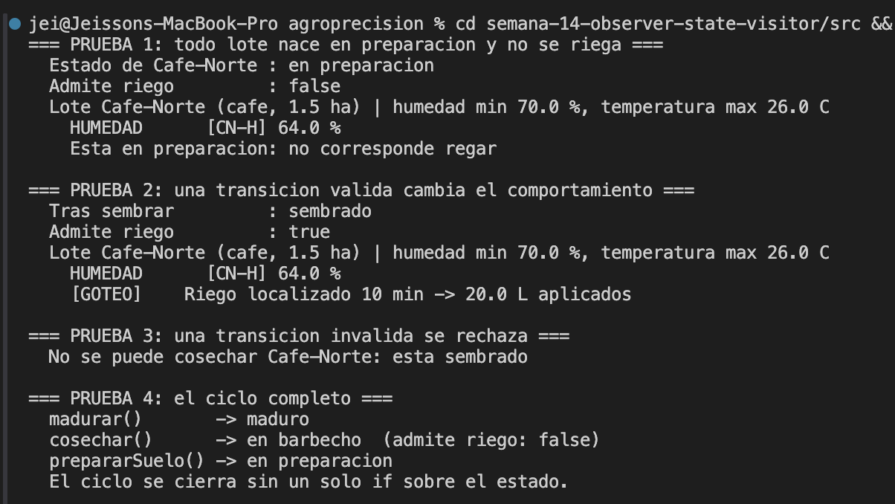
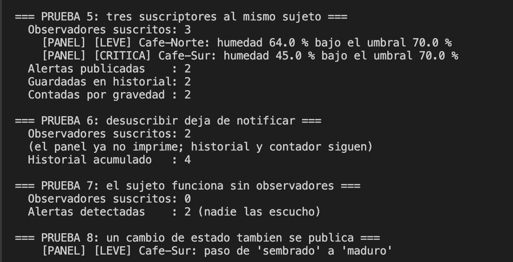
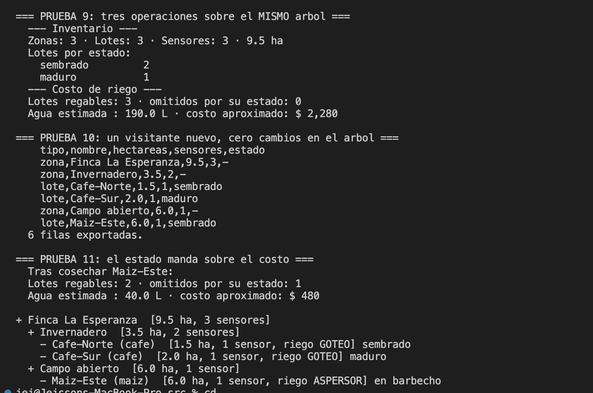
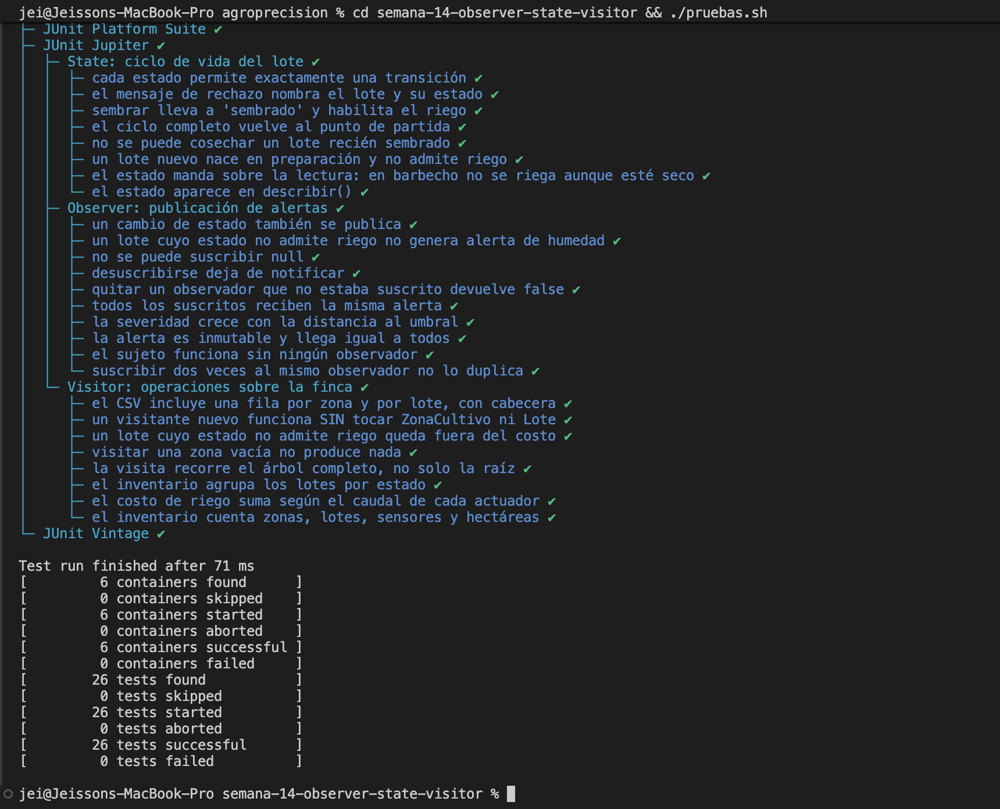

# Semana 14 — Patrones Observer, State y Visitor

Tres patrones **de comportamiento** sobre la misma finca, y se encadenan: **State** cambia el ciclo
de vida del lote, **Observer** avisa a quien quiera enterarse, y **Visitor** reporta sobre el árbol
sin tocarlo.

**Estudiantes:** Jeisson Stewen Berdugo Cely · Darwin Felipe Gil López
**Grupo:** E-195

**Código Observer:** [`MonitorDeAlertas.java`](src/MonitorDeAlertas.java) (sujeto) ·
[`ObservadorAlerta.java`](src/ObservadorAlerta.java) · [`Alerta.java`](src/Alerta.java) ·
[`PanelDeAlertas.java`](src/PanelDeAlertas.java) · [`HistorialAlertas.java`](src/HistorialAlertas.java) · [`ContadorPorSeveridad.java`](src/ContadorPorSeveridad.java)

**Código State:** [`EstadoLote.java`](src/EstadoLote.java) · [`EstadoBase.java`](src/EstadoBase.java) ·
[`EnPreparacion.java`](src/EnPreparacion.java) · [`Sembrado.java`](src/Sembrado.java) ·
[`Maduro.java`](src/Maduro.java) · [`EnBarbecho.java`](src/EnBarbecho.java) · [`Lote.java`](src/Lote.java) (contexto)

**Código Visitor:** [`VisitanteFinca.java`](src/VisitanteFinca.java) ·
[`VisitanteInventario.java`](src/VisitanteInventario.java) · [`VisitanteCostoRiego.java`](src/VisitanteCostoRiego.java) · [`VisitanteExportarCsv.java`](src/VisitanteExportarCsv.java)

**Demo:** [`MainDemoObserverStateVisitor.java`](src/MainDemoObserverStateVisitor.java) ·
**Pruebas:** [`CicloDeVidaLoteTest.java`](test/CicloDeVidaLoteTest.java) · [`AlertasObserverTest.java`](test/AlertasObserverTest.java) · [`VisitantesFincaTest.java`](test/VisitantesFincaTest.java)

**Para ejecutar la demo:**

```bash
cd semana-14-observer-state-visitor/src && javac *.java && java MainDemoObserverStateVisitor
```

**Para ejecutar las pruebas unitarias:**

```bash
cd semana-14-observer-state-visitor && ./pruebas.sh
```

Esta semana adapta **tres** copias, y conviene decir por qué: `ComponenteFinca`, `ZonaCultivo` y
`Lote` ganan `aceptar(VisitanteFinca)`, que es la intrusión que el patrón Visitor exige una sola
vez; y `Lote` pasa además a ser el **contexto** del State. Cada cabecera lo documenta.

---

## Parte 1 — State: el ciclo de vida del lote

### El problema

Un lote no siempre admite lo mismo. Recién preparado no tiene nada que regar; sembrado es cuando
más agua necesita; maduro está listo para cosecha; en barbecho descansa. **Lo que se le puede hacer
cambia con el momento del ciclo.**

Resuelto con un campo y condicionales, el problema se reparte por toda la clase:

```java
public void cosechar() {
    if (estado.equals("maduro")) { ... }
    else throw new IllegalStateException("no se puede");
}
public void regar() {
    if (estado.equals("sembrado") || estado.equals("maduro")) { ... }
}
```

Cada operación repite la lista de estados válidos, y **agregar un estado obliga a revisar todos los
métodos** buscando qué condicionales hay que tocar. Es fácil olvidarse de uno.

### Qué es el State

Es un patrón de comportamiento. Su intención, según el GoF, es permitir que un objeto altere su
comportamiento cuando cambia su estado interno, de modo que parezca que cambió de clase.

Sus roles son el **contexto** (el objeto que tiene estado), el **estado** (la interfaz) y los
**estados concretos**.

### Cómo lo aplicamos

| Rol | Clases |
|---|---|
| Contexto | [`Lote.java`](src/Lote.java) |
| Estado | [`EstadoLote.java`](src/EstadoLote.java) |
| Base común | [`EstadoBase.java`](src/EstadoBase.java) |
| Estados concretos | `EnPreparacion` → `Sembrado` → `Maduro` → `EnBarbecho` → *(vuelve a `EnPreparacion`)* |

| Estado | ¿Admite riego? | Única transición permitida |
|---|---|---|
| `EnPreparacion` | No | `sembrar()` |
| `Sembrado` | **Sí** | `madurar()` |
| `Maduro` | **Sí** | `cosechar()` |
| `EnBarbecho` | No | `prepararSuelo()` |

Tres decisiones que conviene defender:

- **`EstadoBase` rechaza todas las transiciones por defecto**, y cada estado concreto sobreescribe
  solo la que permite. Así una clase de estado ocupa cinco líneas y **es imposible olvidarse de
  prohibir algo**: lo prohibido es el valor por defecto, no algo que haya que recordar escribir.
- **`cambiarEstado()` es de paquete, no público.** Nadie desde fuera fija el estado a mano: se
  llega a él provocando la transición. Es lo que distingue al State de un simple *setter*.
- **El estado manda sobre la lectura.** En `monitorear()`, un lote en barbecho no se riega aunque
  el sensor diga que está seco.

**La frontera con Strategy** (que sigue pendiente): el estado decide **si** el lote admite riego;
Strategy decidirá **cuánta** agua. Es el mismo cuidado con que separamos `ActuadorRiego` —el
dispositivo— de la decisión de regar, allá en la Semana 6.

Y el contraste que van a preguntar: **una estrategia la elige el cliente; un estado lo cambia el
propio objeto**. Aquí nadie dice "pasa a maduro": se llega ahí llamando a `madurar()`.

### Diagrama UML del State



Las flechas punteadas entre los estados concretos dibujan el ciclo y se cierran: de `EnBarbecho`
vuelve a `EnPreparacion`. Ningún estado conoce más que al siguiente.

Fuente del diagrama: [`diagramas/uml-state.mmd`](diagramas/uml-state.mmd).

---

## Parte 2 — Observer: publicación de alertas

### El problema

Cuando un lote baja de su umbral, varios interesados quieren saberlo: el panel del operario, un
historial para auditoría, un contador para el reporte. Y la lista cambia — mañana habrá un
notificador al celular.

Si quien detecta la anomalía llama a cada interesado, **cada interesado nuevo obliga a modificar al
detector**, que no tiene por qué conocerlos.

### Qué es el Observer

Es un patrón de comportamiento. Su intención, según el GoF, es definir una dependencia de uno a
muchos entre objetos, de modo que cuando uno cambie de estado todos sus dependientes sean
notificados automáticamente.

Sus roles son el **sujeto**, el **observador** (la interfaz) y los **observadores concretos**.

### Cómo lo aplicamos

| Rol | Clases |
|---|---|
| Sujeto | [`MonitorDeAlertas.java`](src/MonitorDeAlertas.java) |
| Observador | [`ObservadorAlerta.java`](src/ObservadorAlerta.java) |
| Observadores concretos | `PanelDeAlertas` (imprime) · `HistorialAlertas` (acumula) · `ContadorPorSeveridad` (cuenta) |
| Lo publicado | [`Alerta.java`](src/Alerta.java), inmutable |

El monitor recorre la finca **con el iterador de la Semana 13** y publica una alerta por cada lote
bajo su umbral. La gravedad depende de cuánto falte: 10 puntos es `MEDIA`, 20 o más es `CRITICA`.

Tres decisiones:

- **La lista del sujeto es de interfaces.** El monitor no sabe cuántos observadores hay, ni quiénes
  son, ni qué hacen con el aviso. `ContadorPorSeveridad` se escribió al final y no obligó a
  cambiar nada.
- **Son los observadores los que se suscriben**, no el sujeto quien los registra. Esa inversión es
  justamente lo que lo separa del Mediator.
- **Se notifica sobre una copia de la lista**, para que un observador pueda desuscribirse mientras
  recibe el aviso sin romper el recorrido.

**La frontera con Mediator** (Semana 13), que es el par más confundible del catálogo:

| | Mediator | Observer |
|---|---|---|
| Relación | Muchos a muchos | **Uno a muchos** |
| ¿El emisor conoce al receptor? | Sí: el centro conoce a cada colega concreto | **No**: solo tiene una lista de interfaces |
| Quién registra | El mediador registra a los colegas | **El observador se suscribe solo** |
| Qué hace con el aviso | **Decide** a quién le toca | **Difunde** lo mismo a todos |

### Diagrama UML del Observer



El sujeto apunta a la **interfaz**, no a los observadores concretos. Esa flecha es toda la razón por
la que se pueden agregar suscriptores sin tocarlo.

Fuente del diagrama: [`diagramas/uml-observer.mmd`](diagramas/uml-observer.mmd).

---

## Parte 3 — Visitor: operaciones sobre la finca

### El problema

Este es el único patrón del proyecto cuyo problema **está documentado en nuestro propio historial**.

`ComponenteFinca` empezó en la Semana 8 con tres operaciones. Hoy tiene cinco: `getNombre`,
`getAreaHectareas`, `contarSensores`, `monitorear` y `describir`. **Cada una obligó a tocar la
interfaz, `ZonaCultivo` y `Lote`** — tres archivos por operación. Y las que faltan —inventario,
costo de riego, exportar a CSV— harían lo mismo.

Es el síntoma clásico: una jerarquía **estable** con un conjunto de operaciones que **no para de
crecer**.

### Qué es el Visitor

Es un patrón de comportamiento. Su intención, según el GoF, es representar una operación que se
realiza sobre los elementos de una estructura de objetos, permitiendo definir una operación nueva
**sin cambiar las clases de los elementos**.

Sus roles son el **visitante** (la interfaz), los **visitantes concretos**, el **elemento** (que
declara `aceptar`) y los **elementos concretos**.

### Cómo lo aplicamos

| Rol | Clases |
|---|---|
| Visitante | [`VisitanteFinca.java`](src/VisitanteFinca.java) |
| Visitantes concretos | `VisitanteInventario` · `VisitanteCostoRiego` · `VisitanteExportarCsv` |
| Elementos | `ZonaCultivo` y `Lote`, que ganan `aceptar()` |

**El recorrido vive en el elemento, no en el visitante.** `ZonaCultivo.aceptar()` se visita a sí
misma y propaga a sus hijos; `Lote.aceptar()` solo se visita. Así cada visitante nuevo se escribe
sin repetir la recursión.

El precio del patrón, sin maquillar:

| Lo que cuesta | Por qué lo aceptamos |
|---|---|
| Hay que tocar la jerarquía **una vez** para agregar `aceptar()` | Se paga una sola vez; de ahí en adelante cada operación es gratis |
| **Relaja el encapsulamiento**: el visitante necesita los datos del elemento | Los datos que expone ya eran públicos (`getAreaHectareas`, `contarSensores`) |
| **Es rígido ante tipos nuevos**: un tercer tipo de componente obligaría a tocar todos los visitantes | `ZonaCultivo` y `Lote` no han cambiado desde la Semana 8 |

Esa última fila es la condición de uso del patrón, y aquí se cumple: **la jerarquía es estable y
las operaciones no lo son.** Si fuera al revés, el Visitor sería la decisión equivocada.

### Diagrama UML del Visitor



En la caja de `ComponenteFinca` se ven las cinco operaciones acumuladas y, debajo, `aceptar()`. La
nota señala lo que importa: esa es la última que hubo que agregar ahí.

Fuente del diagrama: [`diagramas/uml-visitor.mmd`](diagramas/uml-visitor.mmd).

---

## Cómo se encadenan los tres

> **State cambia → Observer avisa → Visitor reporta.**

La prueba 11 de la demo lo muestra en números. Antes de cosechar el maizal, `VisitanteCostoRiego`
estima **190 litros**; después de `cosechar()` —que deja el lote en barbecho— el mismo visitante
sobre el mismo árbol estima **40 litros**, porque un lote en barbecho ya no se riega.

El visitante no sabe nada de estados: solo pregunta `lote.admiteRiego()`. Y el monitor de alertas
hace lo mismo: no publica alerta de sequía para un lote que no corresponde regar.

---

## Pruebas unitarias

Veintiséis casos con JUnit 5:

```bash
cd semana-14-observer-state-visitor && ./pruebas.sh
```

| Clase | Caso | Qué comprueba |
|---|---|---|
| `CicloDeVidaLoteTest` | `estadoInicial` / `sembrarHabilitaElRiego` | El comportamiento cambia con el estado |
| | `cicloCompleto` | Las cuatro transiciones cierran el ciclo |
| | `transicionInvalida` | **Una transición rechazada no cambia el estado** |
| | `cadaEstadoPermiteUna` | Recorre los cuatro estados probando todo lo prohibido |
| | `elEstadoMandaSobreLaLectura` | En barbecho no se riega aunque esté seco |
| | `elEstadoSeReporta` / `mensajeDeRechazoUtil` | El estado se ve y el error lo nombra |
| `AlertasObserverTest` | `difusionATodos` | Los tres suscriptores reciben la misma alerta |
| | `desuscribirse` | **El que se fue deja de recibir; el resto sigue** |
| | `sinObservadores` | El sujeto detecta igual sin nadie escuchando |
| | `sinDuplicados` | Suscribir dos veces no notifica dos veces |
| | `severidadSegunLaDistancia` | 25 puntos bajo el umbral → `CRITICA` |
| | `elEstadoFiltraLasAlertas` | Un lote en barbecho no genera alerta de sequía |
| | `publicarCambioDeEstado` | Las transiciones también se publican |
| | `quitarNoSuscrito` / `suscribirNulo` / `alertaInmutable` | Bordes y validación |
| `VisitantesFincaTest` | `inventario` / `inventarioPorEstado` | Cuenta y agrupa por estado |
| | `costoDeRiego` | 2 L/min de goteo + 15 de aspersor = 170 L |
| | `elEstadoFiltraElCosto` | Al cosechar, el costo baja a 150 L |
| | `exportarCsv` | Cabecera, 5 filas y el estado de cada lote |
| | `recorreTodoElArbol` | Coincide con lo que reporta el Composite |
| | `admiteUnVisitanteNuevo` | **Un visitante escrito en la prueba funciona sin tocar el árbol** |
| | `zonaVacia` | Una zona sin hijos produce una sola visita |

Las dos más importantes para sustentar son `admiteUnVisitanteNuevo` —define un `VisitanteNombres`
dentro de la propia prueba, que el código de producción desconoce— y `transicionInvalida`, que
verifica que un rechazo deje el objeto **intacto** y no a medio camino.

---

## Evidencias

Las tres primeras capturas corresponden al código y las cuatro últimas a las ejecuciones —son siete
porque la salida de los visitantes y la de las pruebas no caben juntas—. La numeración continúa la
de las semanas anteriores.

Todo se ejecutó en VS Code sobre Java 17, con el botón *Run* de la extensión de Java.

| Captura | Qué muestra |
|---|---|
| [61](#captura-61) | `EstadoBase`: lo prohibido como valor por defecto |
| [62](#captura-62) | `MonitorDeAlertas.publicar()`: avisar sin saber a quién |
| [63](#captura-63) | El visitante escrito dentro de la prueba |
| [64](#captura-64) | Demo, pruebas 1 a 4: el ciclo de vida |
| [65](#captura-65) | Demo, pruebas 5 a 8: suscribir y desuscribir |
| [66](#captura-66) | Demo, pruebas 9 a 11: los tres visitantes |
| [67](#captura-67) | Las 26 pruebas unitarias en verde |

---

<a id="captura-61"></a>
### Captura 61 — Lo prohibido por defecto



**Archivo:** `src/EstadoBase.java` · **Líneas:** 1 a 23

Las cuatro transiciones rechazan por defecto con un único mensaje. Cada estado concreto sobreescribe
exactamente una, así que olvidarse de prohibir algo es imposible.

<a id="captura-62"></a>
### Captura 62 — Avisar sin saber a quién



**Archivo:** `src/MonitorDeAlertas.java` · **Líneas:** 87 a 100

El bucle recorre una **copia** de la lista —para que un observador pueda desuscribirse mientras
recibe el aviso— y llama a la interfaz. El sujeto no conoce ninguna clase concreta de observador.

<a id="captura-63"></a>
### Captura 63 — Un visitante que el código no conoce



**Archivo:** `test/VisitantesFincaTest.java` · **Líneas:** 127 a 151

`VisitanteNombres` se define dentro de la prueba y recorre la finca entera. Ni `ZonaCultivo` ni
`Lote` saben que existe.

<a id="captura-64"></a>
### Captura 64 — Demo, el ciclo de vida



**Terminal:** salida de `java MainDemoObserverStateVisitor`, pruebas 1 a 4.

El mismo lote, con el mismo sensor marcando 64 %, no se riega en preparación y sí tras sembrar. La
prueba 3 muestra el rechazo con su mensaje, y la 4 cierra el ciclo completo.

<a id="captura-65"></a>
### Captura 65 — Demo, los suscriptores



**Terminal:** salida de `java MainDemoObserverStateVisitor`, pruebas 5 a 8.

Tres suscriptores reciben lo mismo; al quitar el panel deja de imprimir pero el historial sigue
creciendo; sin nadie suscrito el monitor detecta igual.

<a id="captura-66"></a>
### Captura 66 — Demo, los visitantes



**Terminal:** salida de `java MainDemoObserverStateVisitor`, pruebas 9 a 11.

Tres operaciones distintas sobre el mismo árbol: inventario agrupado por estado, costo de riego y el
CSV generado por un visitante escrito al final. Y abajo, la integración de los tres patrones: el
costo baja de **190 a 40 litros** tras cosechar el maizal, porque el lote pasó a barbecho.

<a id="captura-67"></a>
### Captura 67 — Las pruebas unitarias



**Terminal:** salida de `./pruebas.sh`.

Veintiséis pruebas repartidas en los tres patrones, ninguna fallida.

---

## Resultados

| # | Prueba | Patrón | Resultado esperado | Resultado obtenido | Estado | Captura |
|---|---|---|---|---|---|---|
| 1 | Estado inicial | State | `en preparacion`, no admite riego | `Admite riego: false` · `Esta en preparacion: no corresponde regar` | ✅ OK | 64 |
| 2 | Sembrar habilita el riego | State | `sembrado`, y el lote sí riega | Misma lectura de 64.0 %, ahora `[GOTEO] … 20.0 L aplicados` | ✅ OK | 64 |
| 3 | Transición inválida | State | Rechazo con mensaje claro | `No se puede cosechar Cafe-Norte: esta sembrado` | ✅ OK | 64 |
| 4 | Ciclo completo | State | maduro → en barbecho → en preparación | Las tres transiciones, con `admite riego: false` en barbecho | ✅ OK | 64 |
| 5 | Tres suscriptores | Observer | 2 alertas, recibidas por los tres | `2` publicadas · `2` en historial · `2` contadas; una `LEVE` y una `CRITICA` | ✅ OK | 65 |
| 6 | Desuscribir | Observer | El panel calla; el historial sigue | `2` observadores, sin líneas `[PANEL]`, historial acumulado `4` | ✅ OK | 65 |
| 7 | Sin observadores | Observer | Detecta igual, nadie la escucha | `0` observadores · `Alertas detectadas: 2 (nadie las escucho)` | ✅ OK | 65 |
| 8 | Cambio de estado publicado | Observer | Alerta de transición | `[PANEL] [LEVE] Cafe-Sur: paso de 'sembrado' a 'maduro'` | ✅ OK | 65 |
| 9 | Tres visitantes | Visitor | Inventario y costo sobre el mismo árbol | `3 zonas · 3 lotes · 9.5 ha`, agrupados por estado; `190.0 L` | ✅ OK | 66 |
| 10 | Visitante nuevo | Visitor | CSV con cabecera y 6 filas | Cabecera + 3 zonas + 3 lotes con su estado · `6 filas exportadas` | ✅ OK | 66 |
| 11 | El estado manda sobre el costo | Los tres | 190 L → 40 L tras cosechar | `Lotes regables: 2 · omitidos por su estado: 1` · `40.0 L` | ✅ OK | 66 |
| 12 | Pruebas unitarias | Los tres | 26 pruebas exitosas, 0 fallidas | `26 tests successful`, `0 tests failed`, en 71 ms | ✅ OK | 67 |
