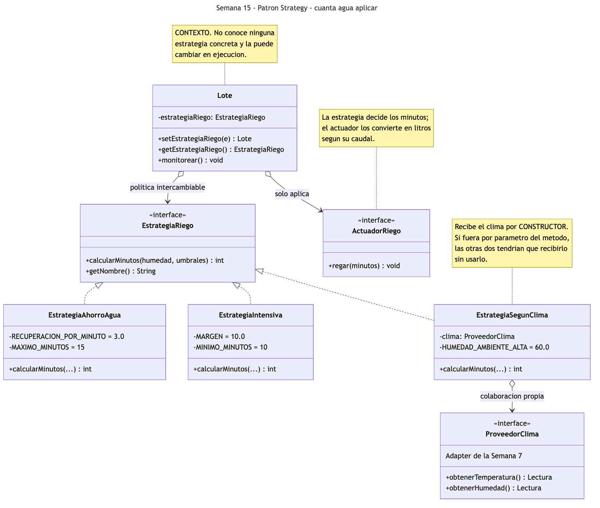
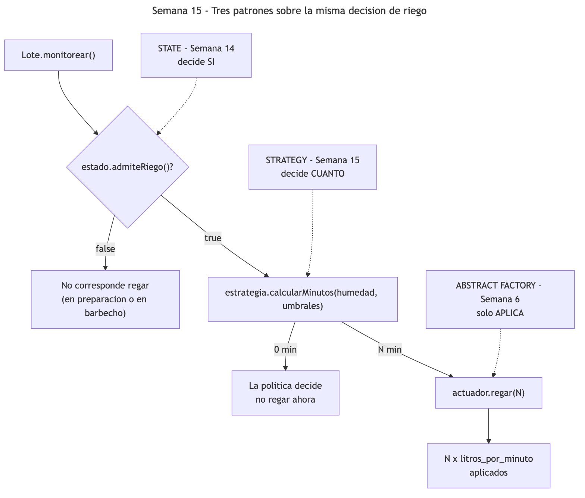
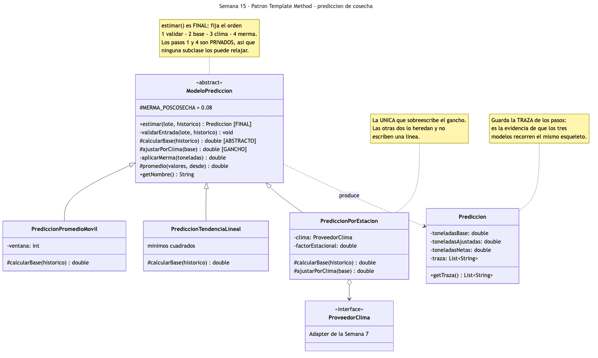
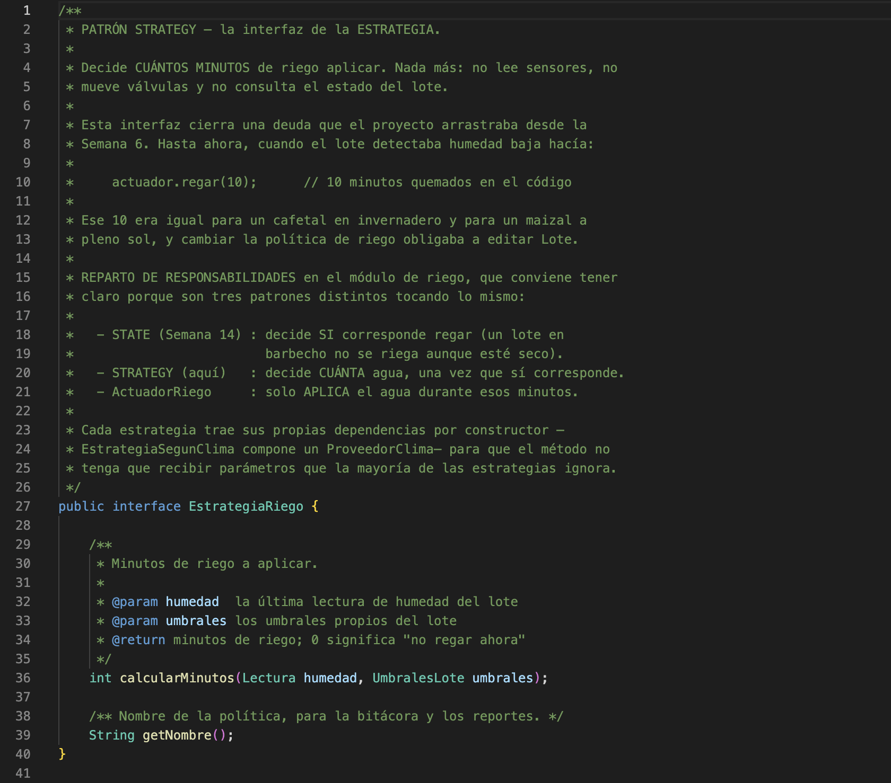
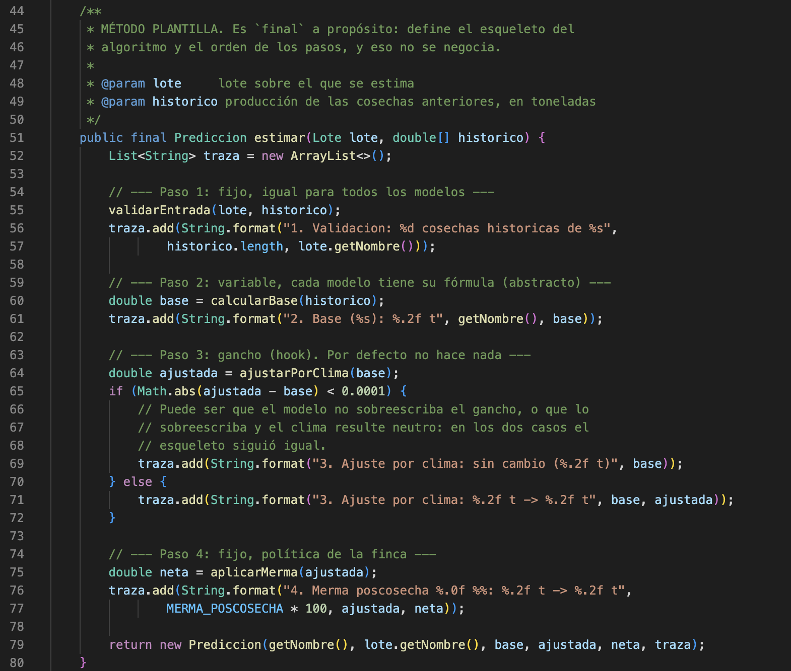
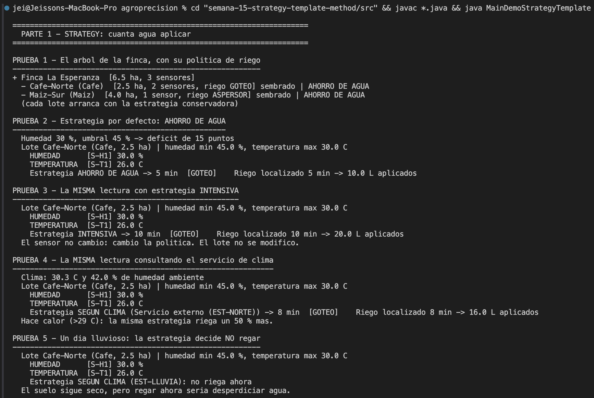
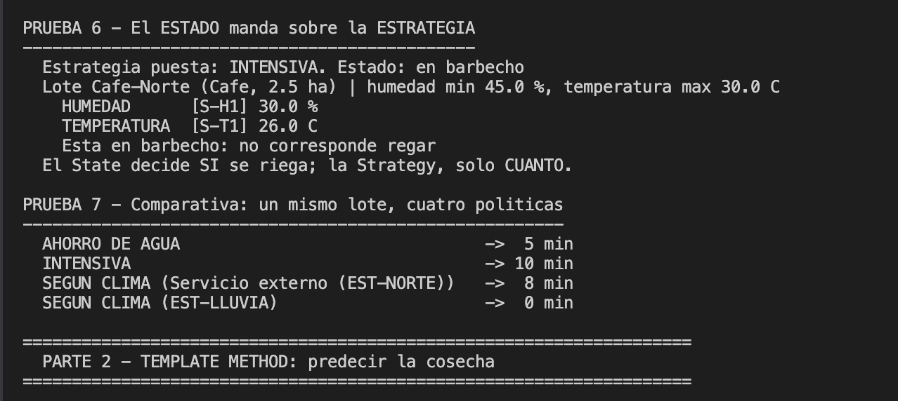
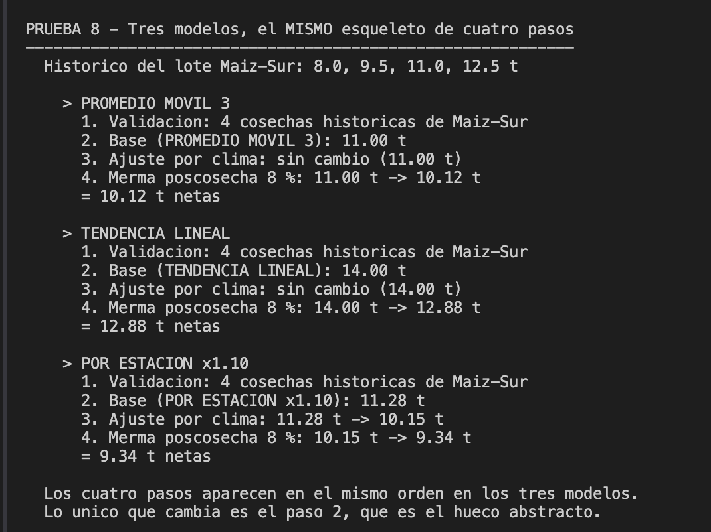
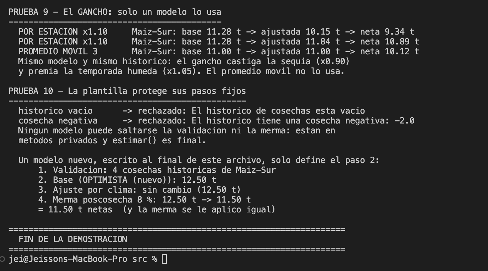
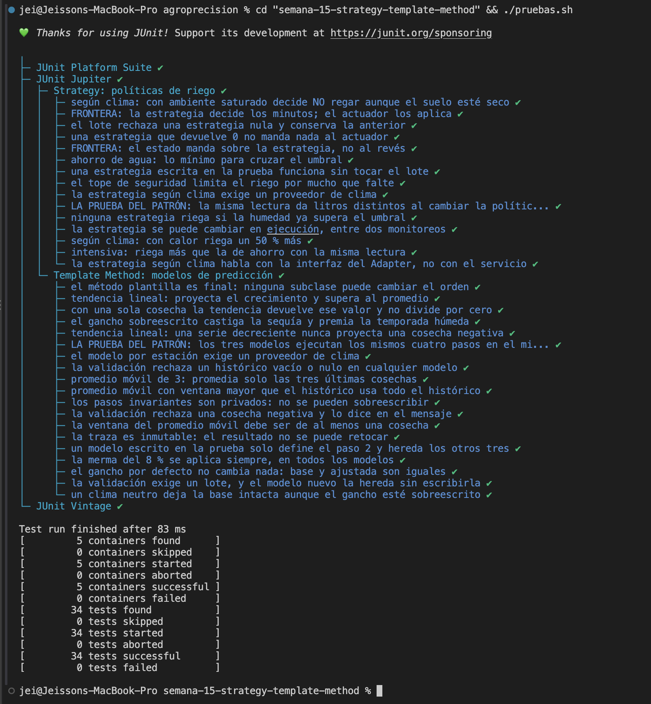

# Semana 15 — Patrones Strategy y Template Method

Dos patrones **de comportamiento** que resuelven el mismo tipo de problema —tener varias versiones
de un algoritmo— con mecanismos opuestos: **Strategy** cambia el algoritmo entero por composición y
en ejecución; **Template Method** fija el esqueleto por herencia y solo deja variar los pasos.

Con esta semana se cierra el catálogo GoF del proyecto.

**Estudiantes:** Jeisson Stewen Berdugo Cely · Darwin Felipe Gil López
**Grupo:** E-195

**Código Strategy:** [`EstrategiaRiego.java`](src/EstrategiaRiego.java) (la estrategia) ·
[`EstrategiaAhorroAgua.java`](src/EstrategiaAhorroAgua.java) ·
[`EstrategiaIntensiva.java`](src/EstrategiaIntensiva.java) ·
[`EstrategiaSegunClima.java`](src/EstrategiaSegunClima.java) ·
[`Lote.java`](src/Lote.java) (contexto)

**Código Template Method:** [`ModeloPrediccion.java`](src/ModeloPrediccion.java) (la plantilla) ·
[`PrediccionPromedioMovil.java`](src/PrediccionPromedioMovil.java) ·
[`PrediccionTendenciaLineal.java`](src/PrediccionTendenciaLineal.java) ·
[`PrediccionPorEstacion.java`](src/PrediccionPorEstacion.java) ·
[`Prediccion.java`](src/Prediccion.java)

**Demo:** [`MainDemoStrategyTemplate.java`](src/MainDemoStrategyTemplate.java) ·
**Pruebas:** [`EstrategiasRiegoTest.java`](test/EstrategiasRiegoTest.java) ·
[`PrediccionTemplateTest.java`](test/PrediccionTemplateTest.java)

**Para ejecutar la demo:**

```bash
cd semana-15-strategy-template-method/src && javac *.java && java MainDemoStrategyTemplate
```

**Para ejecutar las pruebas unitarias:**

```bash
cd semana-15-strategy-template-method && ./pruebas.sh
```

Esta semana adapta una sola copia: `Lote` gana la estrategia de riego y pierde el `aceptar()` del
Visitor, que es de la Semana 14 y aquí no se usa. El **State sí se conserva**, porque es el que
decide si corresponde regar antes de preguntar cuánto.

---

## Parte 1 — Strategy: cuánta agua aplicar

### El problema

El proyecto arrastraba esta línea desde la Semana 6. Cuando el lote detectaba humedad baja, hacía:

```java
actuador.regar(10);      // 10 minutos quemados en el código
```

Ese **10** era el mismo para un cafetal bajo invernadero y para un maizal a pleno sol. Y la finca
no riega siempre igual: hay épocas de ahorro, cultivos en floración que piden saturar el suelo, y
días en que no vale la pena regar porque va a llover.

Resuelto sin patrón, la política de riego termina como una cadena de condicionales dentro de `Lote`:

```java
if (politica.equals("AHORRO"))          minutos = ...;
else if (politica.equals("INTENSIVA"))  minutos = ...;
else if (politica.equals("CLIMA"))      { /* y aquí hay que consultar el servicio... */ }
```

Con eso, **cada política nueva obliga a editar `Lote`**, una clase que no tiene nada que ver con
hidrología. Peor: la política que consulta el clima necesita una colaboración (`ProveedorClima`) que
las otras no usan, así que `Lote` acaba cargando una dependencia para un solo caso.

### Qué es el Strategy

Es un patrón de comportamiento. Su intención, según el GoF, es definir una familia de algoritmos,
encapsular cada uno y hacerlos intercambiables, permitiendo que el algoritmo varíe
independientemente de los clientes que lo usan.

Sus roles son el **contexto** (el objeto que necesita el algoritmo), la **estrategia** (la interfaz
común) y las **estrategias concretas** (cada implementación).

### Cómo lo aplicamos

`EstrategiaRiego` declara un solo método:

```java
int calcularMinutos(Lectura humedad, UmbralesLote umbrales);
```

y `Lote` pasa a tener una estrategia que puede cambiar cuando quiera:

```java
private EstrategiaRiego estrategiaRiego = new EstrategiaAhorroAgua();

public Lote setEstrategiaRiego(EstrategiaRiego estrategia) { ... }
```

Las tres estrategias concretas:

| Estrategia | Qué decide | Con humedad 30 % y umbral 45 % |
|---|---|---|
| `EstrategiaAhorroAgua` | Lo mínimo para cruzar el umbral | **5 min** |
| `EstrategiaIntensiva` | Un margen de 10 puntos por encima | **10 min** |
| `EstrategiaSegunClima` | Consulta el clima; con calor riega 50 % más, con ambiente saturado no riega | **8 min** o **0 min** |

Tres decisiones sobre la misma lectura, tomadas por tres clases distintas, **sin que `Lote` conozca
ninguna de ellas**.

Dos detalles de diseño que conviene poder defender:

1. **La colaboración va en el constructor, no en el método.** `EstrategiaSegunClima` recibe su
   `ProveedorClima` al construirse. Si se pasara como parámetro de `calcularMinutos()`, las otras
   dos estrategias tendrían que recibir un clima que no usan, y la interfaz quedaría sucia.

2. **No encadenamos estrategias.** Sería tentador envolver una estrategia en otra para "sumar"
   políticas, pero eso ya no sería Strategy: sería **Decorator** (Semanas 8 y 9). Cada estrategia
   aquí es autónoma y resuelve el problema completo.

La estrategia se apoya además en el **Adapter de la Semana 7**: habla con la interfaz
`ProveedorClima` y no sabe que detrás hay un servicio que entrega grados Fahrenheit.

### El reparto de responsabilidades

Tres patrones distintos tocan la misma decisión, y cada uno responde una pregunta diferente:

| Patrón | Semana | Pregunta que responde |
|---|---|---|
| **State** | 14 | ¿**Se puede** regar? (en barbecho no, aunque esté seco) |
| **Strategy** | 15 | ¿**Cuánta** agua? |
| **Abstract Factory** | 6 | ¿Con qué dispositivo se **aplica**? (goteo o aspersor) |

La frontera se ve en la prueba `elEstadoMandaSobreLaEstrategia`: con la estrategia intensiva puesta
y el lote en barbecho, **no se riega**, y la estrategia sigue intacta. El estado no la borró; ni
siquiera llegó a preguntarle.

### Diagrama UML del Strategy



Y el recorrido de la decisión completa, con los tres patrones señalados:



---

## Parte 2 — Template Method: predecir la cosecha

### El problema

El módulo de predicción era el último que quedaba vacío del plan inicial. Estimar una cosecha en la
finca sigue siempre el mismo procedimiento, y ese procedimiento es **política de la empresa**, no
del modelo matemático:

1. Validar el histórico de cosechas.
2. Calcular la producción base.
3. Ajustar por clima, si el modelo lo contempla.
4. Descontar la merma de poscosecha (8 %: manipulación, transporte, selección).

De esos cuatro pasos, **solo el segundo cambia** de un modelo a otro. Si cada modelo fuera una clase
independiente, los otros tres se copiarían tres veces, y el día que la finca cambiara el porcentaje
de merma habría que acordarse de editar todas. Peor aún: nada impediría que un modelo se saltara la
validación, o invirtiera el orden y aplicara la merma antes del ajuste.

### Qué es el Template Method

Es un patrón de comportamiento. Su intención, según el GoF, es definir el esqueleto de un algoritmo
en una operación, delegando algunos pasos a las subclases, de modo que estas puedan redefinir esos
pasos sin cambiar la estructura del algoritmo.

Sus roles son la **clase abstracta** (que contiene el método plantilla y los pasos fijos) y las
**subclases concretas** (que rellenan los huecos).

### Cómo lo aplicamos

`ModeloPrediccion.estimar()` es el método plantilla, y es **`final`**:

```java
public final Prediccion estimar(Lote lote, double[] historico) {
    validarEntrada(lote, historico);            // 1. fijo   (privado)
    double base     = calcularBase(historico);  // 2. ABSTRACTO
    double ajustada = ajustarPorClima(base);    // 3. GANCHO
    double neta     = aplicarMerma(ajustada);   // 4. fijo   (privado)
    ...
}
```

Cada palabra clave de ese bloque está elegida a propósito:

- **`final`** en `estimar()`: ninguna subclase puede cambiar el orden de los pasos ni saltarse uno.
- **`private`** en `validarEntrada()` y `aplicarMerma()`: no se pueden sobreescribir ni para
  relajarlos. Son invariantes del negocio.
- **`abstract`** en `calcularBase()`: el único hueco que toda subclase está obligada a rellenar.
- **Gancho** (*hook*) en `ajustarPorClima()`: tiene implementación por defecto —no ajusta nada— y la
  subclase lo sobreescribe **solo si quiere**.

Los tres modelos:

| Modelo | Paso 2 (base) | ¿Usa el gancho? |
|---|---|---|
| `PrediccionPromedioMovil` | Promedio de las últimas N cosechas | No |
| `PrediccionTendenciaLineal` | Mínimos cuadrados, proyecta la siguiente | No |
| `PrediccionPorEstacion` | Promedio × factor estacional | **Sí**: castiga la sequía (×0.90) y premia la temporada húmeda (×1.05) |

Dos de tres no escriben una sola línea del gancho. **Esa es la prueba de que un gancho es opcional**
y la diferencia práctica con un paso abstracto.

### La traza: cómo se demuestra que el esqueleto es el mismo

Decir "todos siguen el mismo procedimiento" no se puede capturar en una foto. Por eso `estimar()`
va anotando cada paso en una lista que viaja dentro del resultado:

```
1. Validacion: 4 cosechas historicas de Maiz-Sur
2. Base (PROMEDIO MOVIL 3): 11.00 t
3. Ajuste por clima: sin cambio (11.00 t)
4. Merma poscosecha 8 %: 11.00 t -> 10.12 t
```

Los tres modelos imprimen **los mismos cuatro renglones en el mismo orden**, con números distintos.
La prueba `elEsqueletoEsElMismo` lo verifica recorriendo la traza de los tres.

### Diagrama UML del Template Method



---

## Strategy vs. Template Method

Los dos resuelven "tengo varias versiones de un algoritmo". Es la comparación que más se pregunta, y
esta semana se puede contestar con código propio del proyecto:

| | **Strategy** (riego) | **Template Method** (predicción) |
|---|---|---|
| Mecanismo | **Composición**: el lote *tiene* una estrategia | **Herencia**: el modelo *es* una subclase |
| Qué varía | El algoritmo **completo** | Solo los **pasos** que la plantilla deja abiertos |
| Cuándo se elige | En **ejecución**, se puede cambiar entre dos llamadas | Al **instanciar**; ya no cambia |
| Quién controla el flujo | El contexto llama a la estrategia | La **plantilla** llama a la subclase (*no me llames, yo te llamo*) |
| Extender | Clase nueva que implementa la interfaz | Clase nueva que hereda y rellena el hueco |
| Riesgo | Muchas clases pequeñas | Acoplar la subclase a la clase base |

La frase corta para sustentar: **Strategy cambia el QUÉ se hace; Template Method fija el ORDEN y
deja variar partes del CÓMO.**

Y el ejemplo que lo deja claro en este proyecto: `cafe.setEstrategiaRiego(new EstrategiaIntensiva())`
funciona a mitad de la demo, entre dos monitoreos. Un `PrediccionPromedioMovil` no se puede
convertir en `PrediccionTendenciaLineal`: hay que crear otro objeto.

---

## Pruebas unitarias

Treinta y cuatro casos con JUnit 5:

```bash
cd semana-15-strategy-template-method && ./pruebas.sh
```

| Clase | Caso | Qué comprueba |
|---|---|---|
| `EstrategiasRiegoTest` | `ahorroDeAgua` / `intensivaRiegaMas` | Cada política calcula lo suyo |
| | `sinDeficitNadieRiega` | Ninguna riega si ya se superó el umbral |
| | `climaCalurosoRiegaMas` / `climaHumedoNoRiega` | El clima cambia la decisión, hasta anularla |
| | `topeDeSeguridad` | Los límites de 15 y 30 minutos se respetan |
| | `mismaLecturaDistintaPolitica` | **La misma lectura da 10 L o 20 L según la estrategia** |
| | `cambioEnEjecucion` | La política se cambia entre dos monitoreos |
| | `estrategiaNuevaSinTocarElLote` | **Una estrategia escrita en la prueba funciona sin modificar `Lote`** |
| | `ceroMinutosNoRiega` | Si la estrategia devuelve 0, el actuador no recibe nada |
| | `elEstadoMandaSobreLaEstrategia` | **Frontera con State**: en barbecho no se riega, y la estrategia sigue puesta |
| | `elActuadorSoloAplica` | Mismos 5 min, 10 L en goteo y 75 L en aspersor |
| | `seApoyaEnElAdapter` | Habla con `ProveedorClima`, no con el servicio en Fahrenheit |
| | `estrategiaNula` / `estrategiaSinClima` | Validación, conservando la estrategia anterior |
| `PrediccionTemplateTest` | `elEsqueletoEsElMismo` | **Los tres modelos ejecutan los mismos 4 pasos en el mismo orden** |
| | `laPlantillaEsFinal` | Por reflexión: `estimar()` es `final` |
| | `losPasosFijosSonPrivados` | Por reflexión: validación y merma son `private` |
| | `lamermaSeAplicaSiempre` | La neta es el 92 % de la ajustada en los cuatro modelos |
| | `promedioMovil` / `ventanaMayorQueElHistorico` | El paso 2 del primer modelo |
| | `tendenciaLineal` / `tendenciaNoNegativa` / `historicoDeUnSoloDato` | El paso 2 del segundo, con sus bordes |
| | `ganchoPorDefecto` | Sin sobreescribir, base y ajustada son iguales |
| | `ganchoSobreescrito` / `ganchoNeutro` | El gancho corrige en los dos sentidos |
| | `historicoInvalido` / `cosechaNegativa` / `sinLote` | La validación fija protege a todos los modelos |
| | `modeloNuevo` | **Un modelo escrito en la prueba solo define el paso 2 y hereda los otros tres** |
| | `ventanaInvalida` / `modeloSinClima` / `trazaInmutable` | Bordes y validación |

Las cuatro en negrita son las que conviene mostrar al sustentar: dos demuestran que el algoritmo es
intercambiable sin tocar al cliente, y dos que el esqueleto es inviolable.

Dos pruebas usan **reflexión** (`Modifier.isFinal`, `Modifier.isPrivate`) porque lo que hay que
verificar no es un valor calculado, sino una **restricción de diseño**: que el compilador impida
alterar el esqueleto. Es el mismo recurso que se usó en la Semana 13 para comprobar que los colegas
del Mediator no se conocían entre sí.

---

## Evidencias

Las dos primeras capturas corresponden al código y las cinco últimas a las ejecuciones. La
numeración continúa la de las semanas anteriores.

Todo se ejecutó en VS Code sobre Java 17, con el botón *Run* de la extensión de Java.

| Captura | Qué muestra |
|---|---|
| [68](#captura-68) | `EstrategiaRiego`: la interfaz y el `regar(10)` que vino a reemplazar |
| [69](#captura-69) | `ModeloPrediccion.estimar()`: el método plantilla, `final` |
| [70](#captura-70) | Demo, pruebas 1 a 5: la misma lectura con cuatro políticas |
| [71](#captura-71) | Demo, pruebas 6 y 7: el estado manda, y la comparativa |
| [72](#captura-72) | Demo, prueba 8: los tres modelos y su traza idéntica |
| [73](#captura-73) | Demo, pruebas 9 y 10: el gancho y los pasos protegidos |
| [74](#captura-74) | Las 34 pruebas unitarias en verde |

---

<a id="captura-68"></a>
### Captura 68 — La política de riego, fuera del lote



**Archivo:** `src/EstrategiaRiego.java` · **Líneas:** 1 a 40

La interfaz y, en su comentario, el `actuador.regar(10)` que estuvo quemado desde la Semana 6. Abajo
queda escrito el reparto: el State decide si, la Strategy cuánto, el actuador solo aplica.

<a id="captura-69"></a>
### Captura 69 — El esqueleto que no se puede tocar



**Archivo:** `src/ModeloPrediccion.java` · **Líneas:** 44 a 80

El método plantilla con sus cuatro pasos numerados. Es `final`, y los pasos 1 y 4 llaman a métodos
privados: una subclase no los puede sobreescribir ni saltar.

<a id="captura-70"></a>
### Captura 70 — Demo, la misma lectura con cuatro políticas



**Terminal:** salida de `java MainDemoStrategyTemplate`, pruebas 1 a 5.

El sensor marca 30 % en las cuatro. Lo único que cambia es la estrategia puesta, y el resultado va
de 10 L a 20 L, pasando por 16 L cuando hace calor y por **no regar** cuando el ambiente está
saturado.

<a id="captura-71"></a>
### Captura 71 — Demo, el estado manda sobre la estrategia



**Terminal:** salida de `java MainDemoStrategyTemplate`, pruebas 6 y 7.

Con la estrategia intensiva puesta y el lote en barbecho, no se riega: el State ni siquiera llega a
preguntarle a la estrategia. Debajo, las cuatro políticas aplicadas al mismo lote.

<a id="captura-72"></a>
### Captura 72 — Demo, tres modelos y un solo esqueleto



**Terminal:** salida de `java MainDemoStrategyTemplate`, prueba 8.

Los cuatro renglones de la traza aparecen en el mismo orden en los tres modelos. Cambian los
números del paso 2, que es el hueco abstracto.

<a id="captura-73"></a>
### Captura 73 — Demo, el gancho y los pasos protegidos



**Terminal:** salida de `java MainDemoStrategyTemplate`, pruebas 9 y 10.

El mismo modelo con clima seco y con clima húmedo da 9.34 t y 10.89 t. Abajo, la plantilla rechaza
un histórico inválido y un modelo nuevo de cinco líneas hereda validación y merma.

<a id="captura-74"></a>
### Captura 74 — Las pruebas unitarias



**Terminal:** salida de `./pruebas.sh`.

Treinta y cuatro pruebas repartidas en los dos patrones, ninguna fallida.

---

## Resultados

| # | Prueba | Patrón | Resultado esperado | Resultado obtenido | Estado | Captura |
|---|---|---|---|---|---|---|
| 1 | El árbol con su política | Strategy | Cada lote muestra estado y estrategia | `sembrado \| AHORRO DE AGUA` en los dos lotes | ✅ OK | 70 |
| 2 | Estrategia por defecto | Strategy | Lo mínimo para cruzar el umbral | `AHORRO DE AGUA -> 5 min` · `10.0 L aplicados` | ✅ OK | 70 |
| 3 | Misma lectura, intensiva | Strategy | Más agua sin tocar el sensor | Humedad 30.0 % igual · `INTENSIVA -> 10 min` · `20.0 L` | ✅ OK | 70 |
| 4 | Misma lectura, según clima | Strategy | Con calor, 50 % más | `30.3 C y 42.0 %` · `-> 8 min` · `16.0 L` | ✅ OK | 70 |
| 5 | Día lluvioso | Strategy | La estrategia decide no regar | `SEGUN CLIMA (EST-LLUVIA): no riega ahora` | ✅ OK | 70 |
| 6 | El estado manda | State + Strategy | En barbecho no riega, con la intensiva puesta | `Esta en barbecho: no corresponde regar` | ✅ OK | 71 |
| 7 | Comparativa | Strategy | Cuatro políticas, cuatro resultados | 5 min · 10 min · 8 min · 0 min | ✅ OK | 71 |
| 8 | Tres modelos | Template Method | Mismo esqueleto, distinto resultado | Las 4 líneas en orden en los tres · 10.12 t, 12.88 t y 9.34 t | ✅ OK | 72 |
| 9 | El gancho | Template Method | Seco castiga, húmedo premia | ajustada `10.15 t` vs `11.84 t` · netas `9.34 t` y `10.89 t` | ✅ OK | 73 |
| 10 | Pasos protegidos | Template Method | La plantilla rechaza entradas inválidas | `El historico de cosechas esta vacio` · `...cosecha negativa: -2.0` | ✅ OK | 73 |
| 11 | Modelo nuevo | Template Method | Solo define el paso 2 y hereda el resto | Base `12.50 t` → neta `11.50 t`, con la misma traza de 4 pasos | ✅ OK | 73 |
| 12 | Pruebas unitarias | Los dos | 34 pruebas exitosas, 0 fallidas | `34 tests successful` · `0 tests failed` (83 ms) | ✅ OK | 74 |
