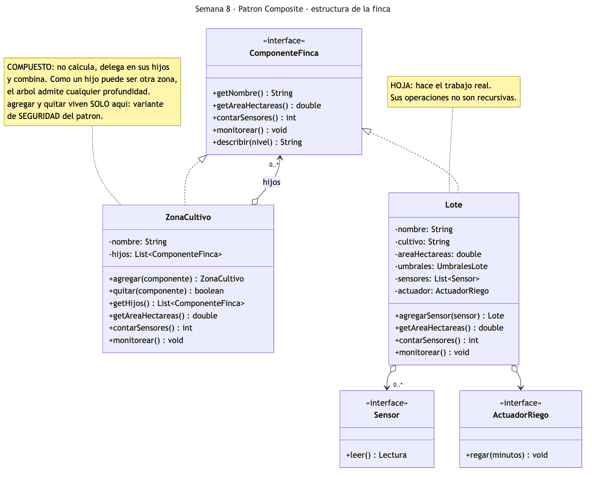
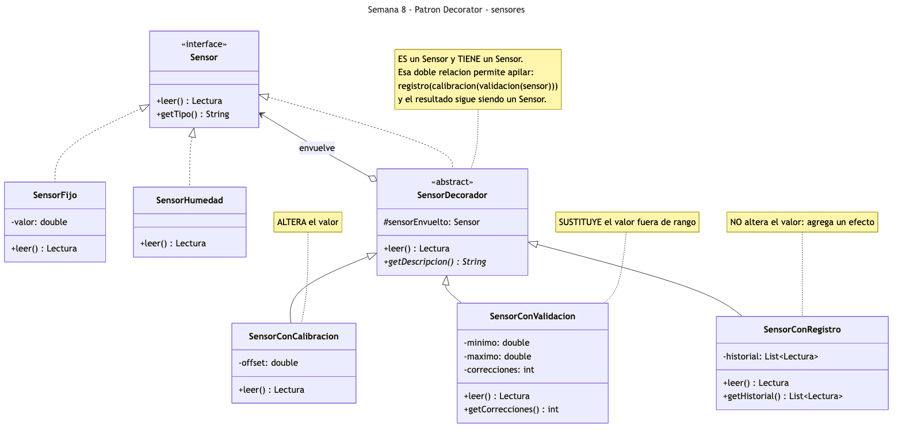
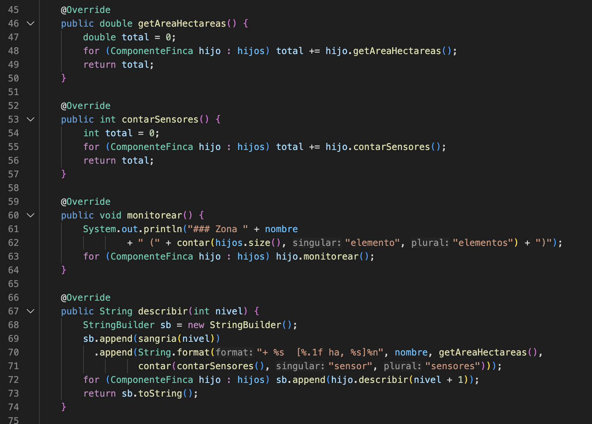
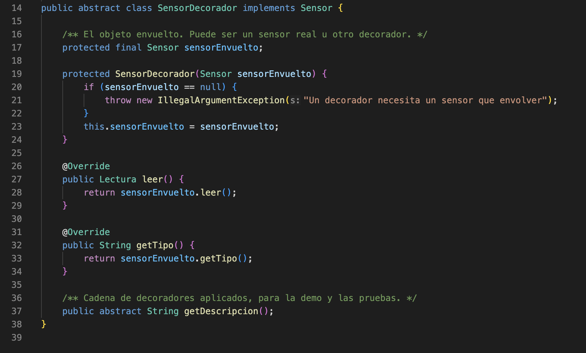
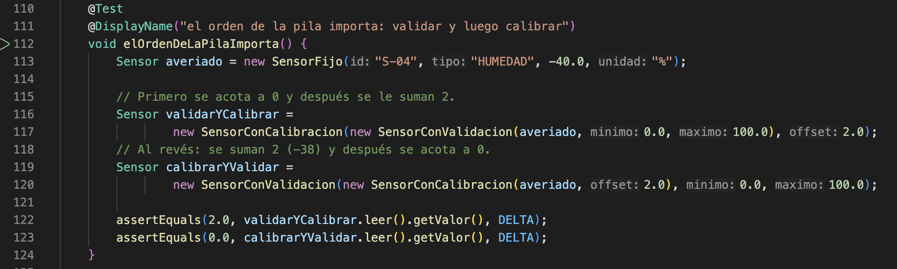
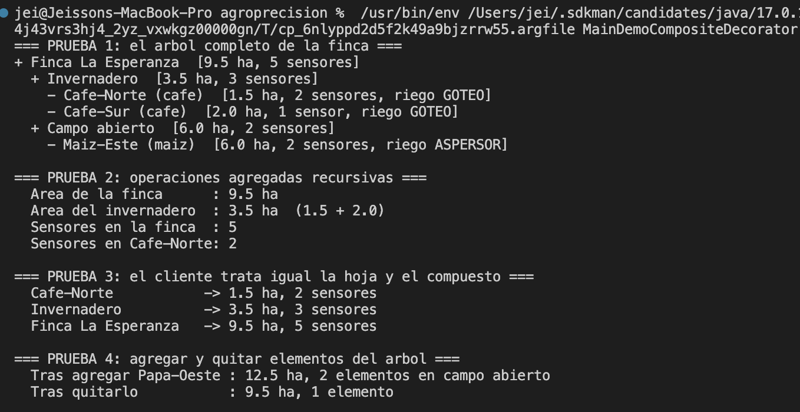
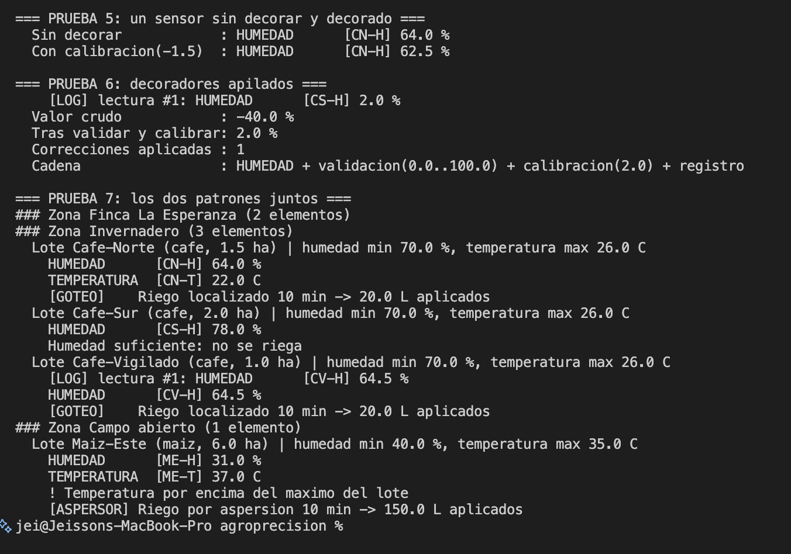
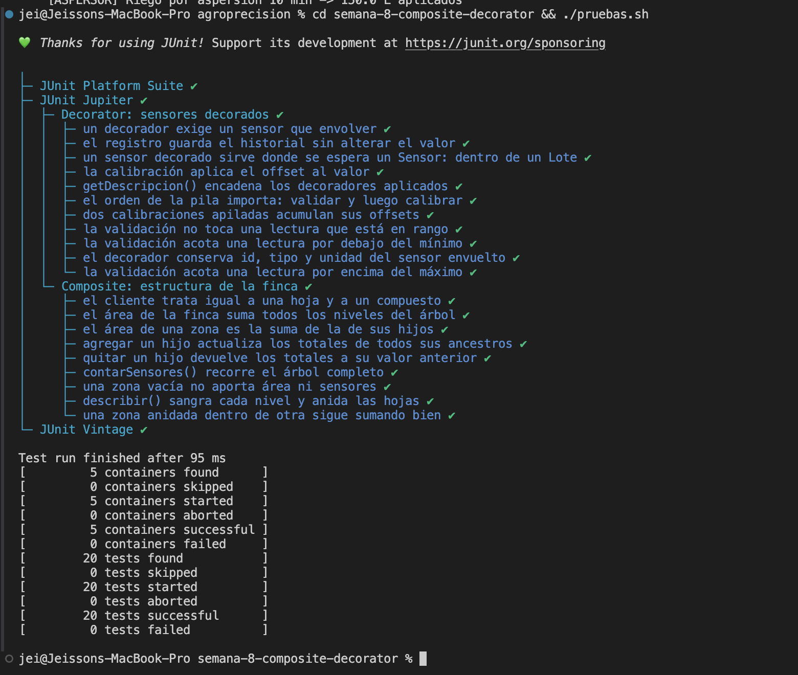

# Semana 8 — Patrones Composite y Decorator

Aplicación de dos patrones estructurales en el prototipo **AgroPrecisión**. **Composite** organiza
la finca como un árbol de zonas y lotes, de modo que preguntar el área o mandar monitorear funcione
igual sobre un lote suelto que sobre la finca entera. **Decorator** añade comportamiento a los
sensores —calibración, validación, registro— envolviéndolos, sin modificar ni una línea de las
clases de sensor existentes.

**Estudiantes:** Jeisson Stewen Berdugo Cely · Darwin Felipe Gil López
**Grupo:** E-195

**Código Composite:** [`ComponenteFinca.java`](src/ComponenteFinca.java) (componente) ·
[`ZonaCultivo.java`](src/ZonaCultivo.java) (compuesto) · [`Lote.java`](src/Lote.java) (hoja)

**Código Decorator:** [`SensorDecorador.java`](src/SensorDecorador.java) (decorador abstracto) ·
[`SensorConCalibracion.java`](src/SensorConCalibracion.java) · [`SensorConValidacion.java`](src/SensorConValidacion.java) ·
[`SensorConRegistro.java`](src/SensorConRegistro.java)

**Demo:** [`MainDemoCompositeDecorator.java`](src/MainDemoCompositeDecorator.java) ·
**Pruebas:** [`CompositeFincaTest.java`](test/CompositeFincaTest.java) · [`SensorDecoradorTest.java`](test/SensorDecoradorTest.java)

**Para ejecutar la demo:**

```bash
cd semana-8-composite-decorator/src && javac *.java && java MainDemoCompositeDecorator
```

**Para ejecutar las pruebas unitarias:**

```bash
cd semana-8-composite-decorator && ./pruebas.sh
```

Las clases `Sensor`, `Lectura`, `ActuadorRiego`, `RiegoGoteo`, `RiegoAspersor`, `UmbralesLote` y
`SensorFijo` están copiadas de semanas anteriores para que esta carpeta compile por sí sola, sin
modificar su contenido. **`Lote` es la única excepción**: su copia aquí sí fue adaptada —declara
`implements ComponenteFinca` y gana `contarSensores()` y `describir()`— y la cabecera del archivo
lo dice explícitamente. El original de la Semana 6 queda intacto.

---

## Parte 1 — Composite: la estructura de la finca

### El problema

Una finca no es una lista plana de lotes: se organiza por zonas, y una zona puede contener otras.
La Finca La Esperanza tiene un invernadero con dos lotes de café y una zona de campo abierto con
un maizal; mañana el invernadero puede dividirse en sectores.

Sobre esa estructura hay preguntas que se hacen a cualquier nivel: cuántas hectáreas tiene, cuántos
sensores hay instalados, mandar monitorear todo. Sin patrón, el cliente tiene que distinguir con
qué está tratando:

```java
if (elemento instanceof Lote) {
    total += ((Lote) elemento).getAreaHectareas();
} else if (elemento instanceof Zona) {
    for (Object hijo : ((Zona) elemento).getLotes()) { ... }   // y si el hijo es otra zona?
}
```

Ese código tiene dos defectos graves. El primero es que el cliente carga con la recursión, y la
repite cada vez que hace falta otra operación agregada. El segundo es que **solo soporta la
profundidad que alguien previó**: agregar un nivel de sectores obliga a reescribir todos esos
bucles.

### Qué es el Composite

Es un patrón estructural. Su intención, según el GoF, es componer objetos en estructuras de árbol
para representar jerarquías parte-todo, permitiendo que los clientes traten de manera uniforme a
los objetos individuales y a sus composiciones. Sus roles son el **componente** (la interfaz común),
la **hoja** (el objeto indivisible que hace el trabajo), el **compuesto** (el que agrupa hijos y
delega en ellos) y el **cliente**.

### Cómo lo aplicamos

| Rol en el patrón | Clases |
|---|---|
| Componente | [`ComponenteFinca.java`](src/ComponenteFinca.java) — `getAreaHectareas()`, `contarSensores()`, `monitorear()`, `describir(nivel)` |
| Hoja | [`Lote.java`](src/Lote.java) — tiene área, sensores y actuador propios |
| Compuesto | [`ZonaCultivo.java`](src/ZonaCultivo.java) — contiene `List<ComponenteFinca>` |
| Cliente | [`MainDemoCompositeDecorator.java`](src/MainDemoCompositeDecorator.java) — el método `informar()` |

Dos decisiones de diseño sostienen la implementación:

- **No existe una clase `Finca`.** La finca es, simplemente, la `ZonaCultivo` de la raíz. Como una
  zona puede contener otras zonas, la recursión ya está resuelta y el árbol admite cualquier
  profundidad sin clases nuevas. Agregar el nivel de sectores no cuesta una sola línea.
- **La gestión de hijos vive solo en el compuesto.** `agregar()` y `quitar()` no están declarados en
  `ComponenteFinca`. El GoF llama a esto la variante de **seguridad**: el compilador impide
  agregarle un hijo a un lote. La alternativa, la variante de **transparencia**, los declararía en
  el componente para que absolutamente todo se tratase igual, pero entonces `Lote` tendría que
  implementarlos lanzando una excepción en tiempo de ejecución. Preferimos que el error lo detecte
  el compilador y no el usuario.

El resultado es que `ZonaCultivo` no calcula nada: pregunta a sus hijos y combina. Por eso el mismo
método `informar(ComponenteFinca)` recibe un lote, una zona o la finca completa sin un solo `if`.

### Diagrama UML del Composite



La relación clave es la flecha de `ZonaCultivo` hacia `ComponenteFinca` rotulada `hijos`: el
compuesto agrega objetos del **mismo tipo que él mismo implementa**, y esa auto-referencia es lo que
genera el árbol. `Lote` y `ZonaCultivo` implementan la misma interfaz, que es lo que hace posible la
uniformidad ante el cliente.

Fuente del diagrama: [`diagramas/uml-composite.mmd`](diagramas/uml-composite.mmd).

---

## Parte 2 — Decorator: sensores

### El problema

Los sensores del prototipo funcionan, pero en campo aparecen necesidades que no estaban previstas:
un sensor de humedad marca sistemáticamente 1.5 puntos de más y hay que **calibrarlo**; otro, con la
conexión suelta, a veces devuelve −40 %, un valor físicamente imposible que hay que **descartar**; y
para auditoría se pide **registrar** cada lectura de los sensores críticos.

La salida fácil es meter todo eso dentro de `SensorHumedad`. El problema es que esas tres
responsabilidades no son del sensor —son de la instalación— y no aplican a todos: el sensor del
invernadero necesita calibración pero no registro, el del maizal al revés. Por herencia saldrían
`SensorHumedadCalibrado`, `SensorHumedadCalibradoConRegistro`, `SensorHumedadValidadoConRegistro`…
una combinación por cada mezcla posible, multiplicada además por cada tipo de sensor.

### Qué es el Decorator

Es un patrón estructural. Su intención, según el GoF, es asignar responsabilidades adicionales a un
objeto de forma dinámica, ofreciendo una alternativa flexible a la herencia para extender la
funcionalidad. Sus roles son el **componente** (la interfaz), el **componente concreto** (el objeto
original), el **decorador** (que implementa la interfaz y envuelve a otro componente) y los
**decoradores concretos**.

La clave está en que el decorador **es** un componente y a la vez **tiene** un componente. Lo
primero le permite ocupar el lugar del objeto original en cualquier parte del sistema; lo segundo,
añadir comportamiento antes o después de delegarle el trabajo.

### Cómo lo aplicamos

| Rol en el patrón | Clases |
|---|---|
| Componente | `Sensor` (de la Semana 4) |
| Componentes concretos | `SensorHumedad`, `SensorTemperatura`, `SensorFijo`… |
| Decorador | [`SensorDecorador.java`](src/SensorDecorador.java) — implementa `Sensor` y guarda un `Sensor` |
| Decoradores concretos | [`SensorConCalibracion.java`](src/SensorConCalibracion.java) · [`SensorConValidacion.java`](src/SensorConValidacion.java) · [`SensorConRegistro.java`](src/SensorConRegistro.java) |

Elegimos a propósito tres decoradores de naturaleza distinta, porque juntos muestran todo el rango
del patrón:

| Decorador | Qué hace con la lectura |
|---|---|
| `SensorConCalibracion` | La **altera**: suma un offset al valor |
| `SensorConValidacion` | La **sustituye** solo si está fuera del rango físico, y cuenta las correcciones |
| `SensorConRegistro` | **No la toca**: agrega un efecto —imprimir y guardar en el historial— alrededor |

Se apilan en cualquier combinación, y el resultado sigue siendo un `Sensor`:

```java
new SensorConRegistro(
    new SensorConCalibracion(
        new SensorConValidacion(sensorAveriado, 0.0, 100.0), 2.0));
```

**El orden importa, y es una ventaja, no un defecto.** Validar y después calibrar un sensor que
devuelve −40 % da 2.0 % (se acota a 0 y luego se suman 2); calibrar y después validar da 0.0 % (se
suman 2 llegando a −38 y luego se acota a 0). El patrón permite expresar esa diferencia eligiendo el
orden de la pila, sin escribir clases distintas. Hay una prueba unitaria dedicada a esto.

### Diagrama UML del Decorator



Hay que mirar dos relaciones a la vez en `SensorDecorador`: la línea punteada hacia `Sensor`
(**es un** sensor) y el rombo rotulado `envuelve`, también hacia `Sensor` (**tiene un** sensor). Esa
doble relación con la misma interfaz es la firma visual del patrón y lo que hace posible apilar
decoradores indefinidamente.

---

## Cómo se combinan los dos patrones

La prueba 7 de la demo es la que une la semana: **Composite organiza la estructura, Decorator
enriquece las piezas**. Se agrega al invernadero un lote cuyo sensor viene envuelto en calibración y
registro, y se llama `finca.monitorear()`. La cascada recorre el árbol y, al llegar a ese lote, se
ven los efectos de los decoradores —el valor corregido y la línea `[LOG]`— sin que la zona ni el lote
sepan que hay decoradores de por medio. Para ellos sigue siendo un `Sensor`.

---

## Pruebas unitarias

Veinte casos con JUnit 5, ejecutados con el jar autónomo de [`lib/`](../lib/):

```bash
cd semana-8-composite-decorator && ./pruebas.sh
```

| Clase de prueba | Caso | Qué comprueba |
|---|---|---|
| `CompositeFincaTest` | `areaDeUnaZona` | 1.5 + 2.0 = 3.5 ha en el invernadero |
| | `areaRecursivaDeLaFinca` | 3.5 + 6.0 = 9.5 ha sumando dos niveles |
| | `contarSensoresEsRecursivo` | 2 en la hoja, 3 en la zona, 5 en la finca |
| | `zonaVacia` | Una zona sin hijos da 0 y 0 |
| | `agregarPropagaHaciaArriba` | Agregar un lote actualiza zona **y** finca |
| | `quitarRestaDelTotal` | Quitar revierte el total; quitar dos veces da `false` |
| | `hojaYCompuestoSonIntercambiables` | Mismo tipo estático para lote y finca |
| | `describirMuestraLaJerarquia` | Sangría por nivel y concordancia `1 sensor` |
| | `anidamientoDeVariosNiveles` | Una zona dentro de otra sigue sumando bien |
| `SensorDecoradorTest` | `calibracionAplicaElOffset` | 64.0 − 1.5 = 62.5 |
| | `conservaLosDemasCampos` | Id, tipo y unidad intactos |
| | `calibracionesApiladasSeAcumulan` | 64.0 − 1.5 + 0.5 = 63.0 |
| | `validacionCorrigePorDebajo` | −40 → 0, y una corrección contada |
| | `validacionCorrigePorEncima` | 180 → 100 |
| | `validacionRespetaLoCorrecto` | 64.0 pasa intacto, cero correcciones |
| | `registroNoAlteraElValor` | Valor igual y dos entradas en el historial |
| | `elOrdenDeLaPilaImporta` | 2.0 % frente a 0.0 % según el orden |
| | `describeLaCadena` | `getDescripcion()` encadena los tres |
| | `noSePuedeDecorarNada` | Decorar `null` lanza `IllegalArgumentException` |
| | `elDecoradoEncajaEnElComposite` | Un sensor decorado funciona dentro de un `Lote` del árbol |

Las dos últimas son las más importantes para sustentar: una protege la invariante del patrón —un
decorador sin nada que envolver no tiene sentido— y la otra demuestra, en ejecución, que los dos
patrones de la semana se componen sin saber el uno del otro.

---

## Evidencias

Estas son las pruebas que ejecutamos para comprobar que los dos patrones funcionan como
esperábamos. Las tres primeras capturas corresponden al código y las tres últimas a las ejecuciones.
La numeración continúa la de las semanas anteriores.

Todo se ejecutó en VS Code sobre Java 17, con el botón *Run* de la extensión de Java.

| Captura | Qué muestra |
|---|---|
| [31](#captura-31) | `ZonaCultivo`: las operaciones recursivas del compuesto |
| [32](#captura-32) | `SensorDecorador`: es un `Sensor` y tiene un `Sensor` |
| [33](#captura-33) | La prueba de que el orden de la pila cambia el resultado |
| [34](#captura-34) | Demo, pruebas 1 a 4: el árbol y las operaciones agregadas |
| [35](#captura-35) | Demo, pruebas 5 a 7: decoradores y los dos patrones juntos |
| [36](#captura-36) | Las 20 pruebas unitarias en verde |

---

<a id="captura-31"></a>
### Captura 31 — El compuesto



**Archivo:** `src/ZonaCultivo.java` · **Líneas:** 45 a 75

`getAreaHectareas()` y `contarSensores()` no calculan nada por sí mismos: recorren los hijos y
acumulan. Como un hijo puede ser otra `ZonaCultivo`, la llamada se propaga sola hasta las hojas. Es
el corazón del patrón en seis líneas.

<a id="captura-32"></a>
### Captura 32 — El decorador abstracto



**Archivo:** `src/SensorDecorador.java` · **Líneas:** 14 a 38

`implements Sensor` en la declaración y `protected final Sensor sensorEnvuelto` en el campo: la
doble relación que define al patrón. `leer()` delega sin hacer nada, y cada decorador concreto
sobreescribe solo lo que necesita cambiar.

<a id="captura-33"></a>
### Captura 33 — El orden de la pila importa



**Archivo:** `test/SensorDecoradorTest.java` · **Líneas:** 110 a 124

Los mismos dos decoradores sobre el mismo sensor averiado, en los dos órdenes posibles, dan 2.0 % y
0.0 %. Es la demostración de que el patrón no solo agrega comportamiento: permite **componerlo**.

<a id="captura-34"></a>
### Captura 34 — Demo, el Composite



**Terminal:** salida de `java MainDemoCompositeDecorator`, pruebas 1 a 4.

El árbol impreso con sangría, los totales recursivos (9.5 ha y 5 sensores en la finca) y el mismo
método `informar()` aplicado a un lote, a una zona y a la finca. En la prueba 4 se ve que agregar y
quitar un lote actualiza los totales de todos sus ancestros.

<a id="captura-35"></a>
### Captura 35 — Demo, el Decorator



**Terminal:** salida de `java MainDemoCompositeDecorator`, pruebas 5 a 7.

El sensor sin decorar y calibrado, la pila de tres decoradores convirtiendo −40 % en un valor válido
y, en la prueba 7, el monitoreo en cascada de toda la finca con un lote cuyo sensor está decorado.

<a id="captura-36"></a>
### Captura 36 — Las pruebas unitarias



**Terminal:** salida de `./pruebas.sh`.

Veinte pruebas, ninguna fallida.

---

## Resultados

| # | Prueba | Patrón | Resultado esperado | Resultado obtenido | Estado | Captura |
|---|---|---|---|---|---|---|
| 1 | El árbol de la finca | Composite | Tres niveles con sangría | Finca → Invernadero (2 lotes) y Campo abierto (1 lote); `1 sensor` en singular | ✅ OK | 34 |
| 2 | Operaciones agregadas | Composite | 9.5 ha y 5 sensores en la finca | `9.5 ha` · `3.5 ha` el invernadero · `5` y `2` sensores | ✅ OK | 34 |
| 3 | Hoja y compuesto iguales | Composite | El mismo método sirve para los tres | `informar()` imprime lote, zona y finca sin ningún `if` | ✅ OK | 34 |
| 4 | Agregar y quitar | Composite | 12.5 ha al agregar, 9.5 ha al quitar | `12.5 ha, 2 elementos` → `9.5 ha, 1 elemento` | ✅ OK | 34 |
| 5 | Sensor decorado | Decorator | 64.0 % → 62.5 % con offset −1.5 | `[CN-H] 64.0 %` → `[CN-H] 62.5 %` | ✅ OK | 35 |
| 6 | Decoradores apilados | Decorator | −40 % → 2.0 %, 1 corrección, cadena completa | `2.0 %`, `1` corrección, `HUMEDAD + validacion(0.0..100.0) + calibracion(2.0) + registro` | ✅ OK | 35 |
| 7 | Los dos patrones juntos | Ambos | Cascada por el árbol con el `[LOG]` del lote decorado | Cafe-Vigilado imprime `[LOG] lectura #1` y `64.5 %` (66.0 − 1.5) dentro del recorrido | ✅ OK | 35 |
| 8 | Pruebas unitarias | Ambos | 20 pruebas exitosas, 0 fallidas | `20 tests successful`, `0 tests failed`, en 95 ms | ✅ OK | 36 |
