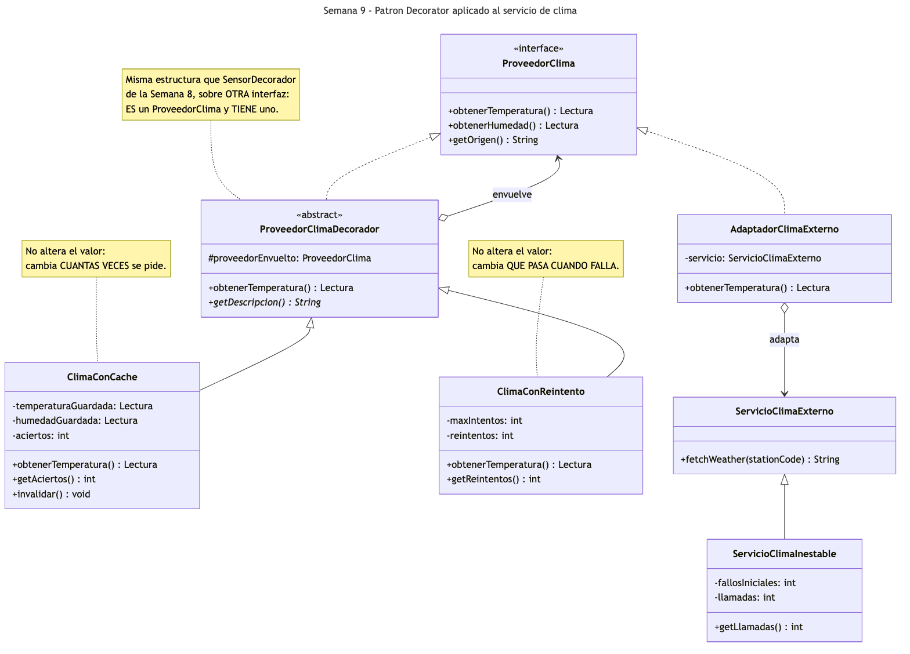
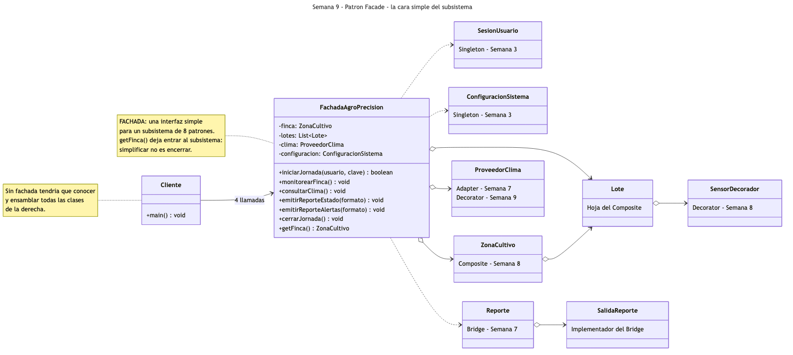
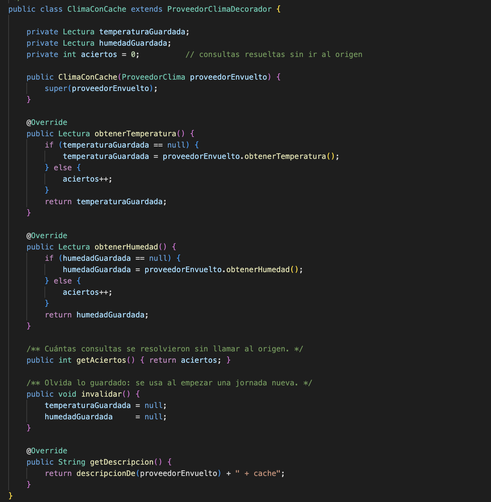
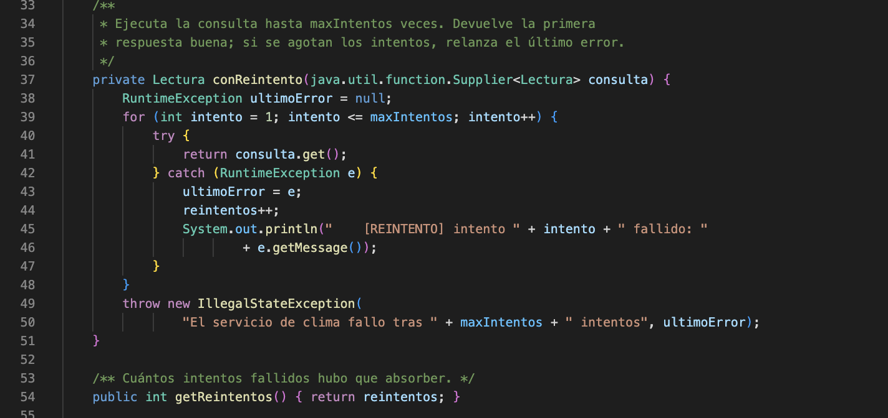
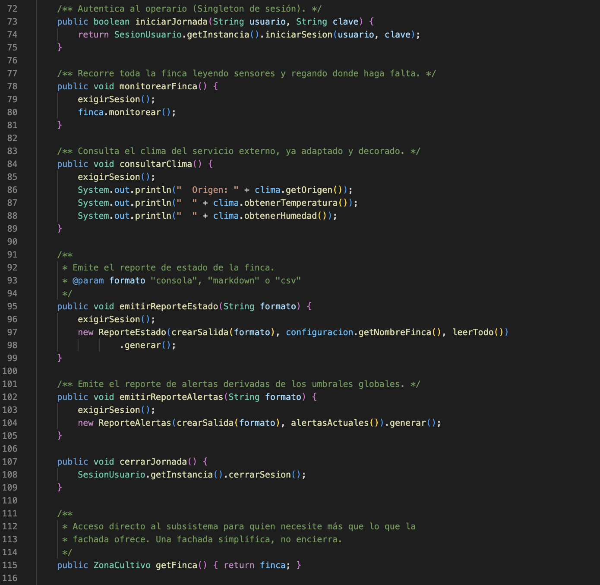
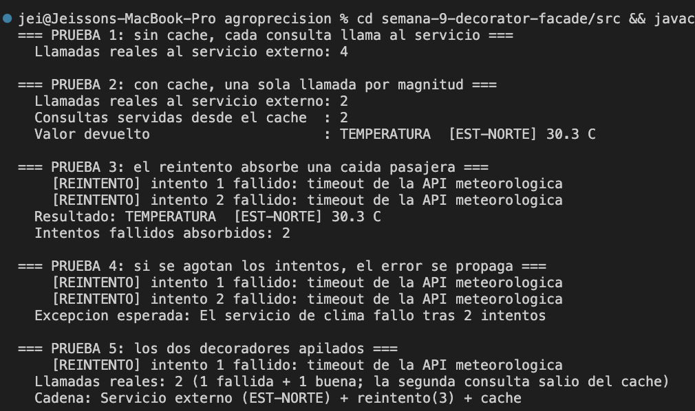
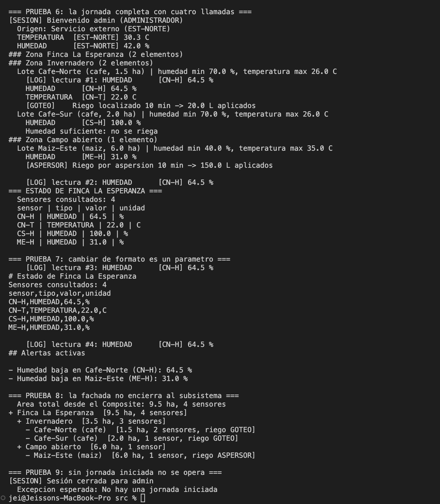
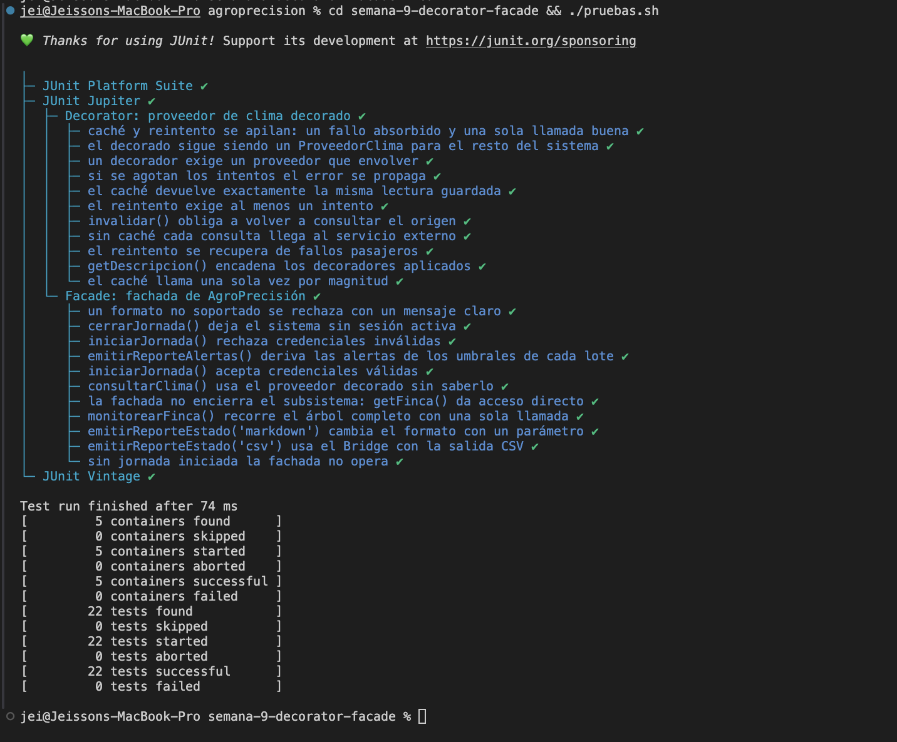

# Semana 9 — Patrones Decorator y Facade

Aplicación de dos patrones estructurales en el prototipo **AgroPrecisión**. **Decorator** se aplica
esta vez al **servicio de clima**, añadiéndole caché y reintento sin tocar el adaptador que lo
consulta. **Facade** pone una cara simple —cuatro operaciones de negocio— sobre un subsistema que a
estas alturas del proyecto involucra ocho patrones y más de veinte clases.

**Estudiantes:** Jeisson Stewen Berdugo Cely · Darwin Felipe Gil López
**Grupo:** E-195

> **Sobre el Decorator:** el patrón se introdujo en la [Semana 8](../semana-8-composite-decorator/)
> aplicado a los sensores. Aquí **no se repite** aquel trabajo: se aplica el mismo mecanismo a otra
> interfaz del sistema, `ProveedorClima`, para demostrar que es independiente del dominio y que un
> patrón bien elegido se reutiliza sobre cualquier abstracción.

**Código Decorator:** [`ProveedorClimaDecorador.java`](src/ProveedorClimaDecorador.java) (decorador abstracto) ·
[`ClimaConCache.java`](src/ClimaConCache.java) · [`ClimaConReintento.java`](src/ClimaConReintento.java) ·
[`ServicioClimaInestable.java`](src/ServicioClimaInestable.java) (banco de pruebas)

**Código Facade:** [`FachadaAgroPrecision.java`](src/FachadaAgroPrecision.java)

**Demo:** [`MainDemoDecoratorFacade.java`](src/MainDemoDecoratorFacade.java) ·
**Pruebas:** [`ClimaDecoradorTest.java`](test/ClimaDecoradorTest.java) · [`FachadaAgroPrecisionTest.java`](test/FachadaAgroPrecisionTest.java)

**Para ejecutar la demo:**

```bash
cd semana-9-decorator-facade/src && javac *.java && java MainDemoDecoratorFacade
```

**Para ejecutar las pruebas unitarias:**

```bash
cd semana-9-decorator-facade && ./pruebas.sh
```

Esta semana copia más clases que ninguna otra —veintiséis— porque la fachada necesita el subsistema
completo para tener sentido: los Singleton de la Semana 3, los sensores de la 4, el equipamiento de
la 6, el Adapter y el Bridge de la 7 y el Composite con sus decoradores de la 8. Ninguna fue
modificada; cada archivo lo indica en su cabecera.

---

## Parte 1 — Decorator: el servicio de clima

### El problema

El `AdaptadorClimaExterno` de la Semana 7 funciona, pero el servicio al que consulta es una API de
terceros, con los dos problemas que eso siempre trae:

- **Cada llamada cuesta.** Durante una jornada de monitoreo el dato no cambia, pero el reporte de
  estado, el de alertas y el módulo de riego lo piden por separado: cuatro llamadas donde bastaba
  una.
- **A veces se cae.** Un *timeout* pasajero no debería tumbar el monitoreo de toda la finca.

Las dos soluciones —cachear y reintentar— son responsabilidades que **no pertenecen al adaptador**.
Su trabajo es traducir formatos y unidades, y ya lo hace bien. Meterle el caché dentro significaría
que una clase haga dos cosas y que quien no quiera caché no pueda evitarlo. Y por herencia saldrían
`AdaptadorConCache`, `AdaptadorConReintento`, `AdaptadorConCacheYReintento`: la explosión
combinatoria de siempre.

### Qué es el Decorator

Es un patrón estructural. Su intención, según el GoF, es asignar responsabilidades adicionales a un
objeto de forma dinámica, ofreciendo una alternativa flexible a la herencia. El decorador
**implementa** la interfaz del objeto que envuelve y **contiene** uno: lo primero le permite ocupar
su lugar en cualquier parte del sistema, lo segundo añadir comportamiento alrededor.

### Cómo lo aplicamos

| Rol en el patrón | Clases |
|---|---|
| Componente | `ProveedorClima` (de la Semana 7) |
| Componentes concretos | `AdaptadorClimaExterno`, `ProveedorSensoresPropios` |
| Decorador | [`ProveedorClimaDecorador.java`](src/ProveedorClimaDecorador.java) |
| Decoradores concretos | [`ClimaConCache.java`](src/ClimaConCache.java) · [`ClimaConReintento.java`](src/ClimaConReintento.java) |

Lo interesante es compararlo con la Semana 8. Allí los decoradores **alteraban el dato**: la
calibración le sumaba un offset, la validación lo sustituía. Aquí ninguno de los dos toca el valor:

| Decorador | Qué cambia |
|---|---|
| `ClimaConCache` | **Cuántas veces** se pide el dato. Guarda la primera respuesta y cuenta los aciertos |
| `ClimaConReintento` | **Qué pasa cuando falla**. Reintenta hasta `maxIntentos` y solo entonces propaga el error |

Esa diferencia es la que conviene sustentar: el Decorator no es "un patrón para transformar datos",
es un patrón para **añadir responsabilidades**, sean del tipo que sean. Un decorador puede cambiar
el valor, el número de llamadas, el manejo de errores o simplemente observar.

Para demostrarlo hace falta un servicio que se porte mal a voluntad:
[`ServicioClimaInestable`](src/ServicioClimaInestable.java) cuenta cuántas veces lo llamaron —así se
mide el efecto del caché— y falla las primeras N llamadas —así se mide el del reintento—. No forma
parte de ningún patrón: es el banco de pruebas.

### Diagrama UML del Decorator



La estructura es idéntica a la de la Semana 8 pero sobre otra interfaz: `ProveedorClimaDecorador`
implementa `ProveedorClima` (realización) y a la vez lo agrega (rombo rotulado `envuelve`). A la
derecha se ve cómo convive con el Adapter: el adaptador es un componente concreto más, y los
decoradores lo envuelven sin saber que por dentro hay una traducción de unidades.

Fuente del diagrama: [`diagramas/uml-decorator-clima.mmd`](diagramas/uml-decorator-clima.mmd).

---

## Parte 2 — Facade: la cara simple del sistema

### El problema

Después de ocho semanas, "hacer la jornada de la finca" exige conocer medio proyecto. El cliente
tendría que: obtener el Singleton de sesión y autenticar; crear los sensores y envolverlos en los
decoradores que correspondan; construir cada `Lote`, equiparlo y montarlo en el árbol de
`ZonaCultivo`; instanciar el servicio externo, adaptarlo y decorarlo; recorrer el árbol; y para el
reporte, elegir la salida del Bridge y armar el `ReporteEstado`.

Son unas treinta líneas de ensamblaje y, sobre todo, **el conocimiento de qué va con qué**. Cada
cliente nuevo —el menú de consola, un script de pruebas, un futuro módulo de predicción— tendría que
repetirlas, y cualquier cambio interno del subsistema los rompería a todos.

### Qué es el Facade

Es un patrón estructural. Su intención, según el GoF, es proporcionar una interfaz unificada para un
conjunto de interfaces de un subsistema, definiendo una interfaz de más alto nivel que lo hace más
fácil de usar. Sus roles son solo dos: la **fachada** y las **clases del subsistema**.

Un punto que el GoF subraya y que es fácil de pasar por alto: la fachada **no encapsula** el
subsistema. No lo oculta ni prohíbe el acceso; simplemente ofrece el camino corto para el caso
común. Quien necesite algo que la fachada no da, entra directo.

### Cómo lo aplicamos

| Rol en el patrón | Clases |
|---|---|
| Fachada | [`FachadaAgroPrecision.java`](src/FachadaAgroPrecision.java) |
| Subsistema | `SesionUsuario`, `ConfiguracionSistema`, `ZonaCultivo`, `Lote`, los `SensorDecorador`, `ProveedorClima` con su adaptador y decoradores, `Reporte` y las `SalidaReporte` |
| Cliente | [`MainDemoDecoratorFacade.java`](src/MainDemoDecoratorFacade.java) |

La fachada expone seis operaciones que hablan el idioma del negocio, no el del código:
`iniciarJornada()`, `monitorearFinca()`, `consultarClima()`, `emitirReporteEstado(formato)`,
`emitirReporteAlertas(formato)` y `cerrarJornada()`. Una jornada completa queda así:

```java
FachadaAgroPrecision sistema = new FachadaAgroPrecision(climaRobusto);
sistema.iniciarJornada("admin", "1234");
sistema.consultarClima();
sistema.monitorearFinca();
sistema.emitirReporteEstado("consola");
```

Tres decisiones sostienen la implementación:

- **La fachada no encierra.** `getFinca()` devuelve el árbol del Composite para quien necesite
  operar directamente sobre el subsistema. Simplificar no es amurallar: una fachada que esconde
  todo acaba creciendo hasta duplicar el subsistema entero.
- **El clima entra por el constructor.** La fachada recibe un `ProveedorClima` ya decorado y **no
  sabe** que lleva caché y reintento detrás. Es la prueba de que el Decorator de la Parte 1 es
  transparente: para la fachada sigue siendo la misma interfaz de la Semana 7.
- **La fachada no añade reglas de negocio nuevas**, salvo una comprobación de estado:
  `exigirSesion()` impide operar sin jornada iniciada. Todo lo demás lo sigue haciendo el
  subsistema; la fachada solo orquesta.

### Diagrama UML del Facade



El diagrama es, deliberadamente, un mapa del proyecto entero: a la izquierda el cliente con una sola
flecha, a la derecha las clases del subsistema anotadas con la semana y el patrón de donde vienen.
Esa asimetría —una flecha frente a ocho— es exactamente lo que el patrón compra.

Fuente del diagrama: [`diagramas/uml-facade.mmd`](diagramas/uml-facade.mmd).

---

## Cómo se combinan los dos patrones

La prueba 6 de la demo los une: se construye un `ClimaConCache(ClimaConReintento(adaptador))` y se
le pasa a la fachada. La fachada lo guarda como un `ProveedorClima` cualquiera y lo usa en
`consultarClima()`. Ni la fachada ni el reporte ni el módulo de riego saben que hay dos decoradores
de por medio; lo único observable es que el servicio externo recibe menos llamadas y que un fallo
pasajero no tumba la jornada.

---

## Pruebas unitarias

Veintidós casos con JUnit 5, ejecutados con el jar autónomo de [`lib/`](../lib/):

```bash
cd semana-9-decorator-facade && ./pruebas.sh
```

| Clase de prueba | Caso | Qué comprueba |
|---|---|---|
| `ClimaDecoradorTest` | `sinCacheSeLlamaSiempre` | 2 consultas → 2 llamadas reales |
| | `elCacheEvitaLlamadasRepetidas` | 4 consultas → 2 llamadas y 2 aciertos de caché |
| | `elCacheDevuelveLoMismo` | La segunda consulta devuelve **la misma instancia** |
| | `invalidarVuelveAConsultar` | Tras `invalidar()` se vuelve al origen |
| | `elReintentoAbsorbeFallos` | 2 fallos y la tercera responde: valor correcto |
| | `elReintentoSeRinde` | Agotados los intentos, `IllegalStateException` |
| | `reintentoConCeroIntentos` | Configuración inválida rechazada |
| | `decoradoresApilados` | Caché + reintento: 1 fallo absorbido, 1 acierto |
| | `describeLaCadena` | `getDescripcion()` encadena los dos |
| | `noSePuedeDecorarNada` | Decorar `null` lanza `IllegalArgumentException` |
| | `elDecoradoConservaLaInterfaz` | El decorado sigue siendo un `ProveedorClima` |
| `FachadaAgroPrecisionTest` | `jornadaConCredencialesValidas` / `Invalidas` | La fachada delega en el Singleton de sesión |
| | `exigeJornadaIniciada` | Operar sin sesión lanza `IllegalStateException` |
| | `monitorearRecorreTodaLaFinca` | Una llamada recorre zonas y lotes |
| | `reporteEnCsv` / `reporteEnMarkdown` | Cambiar de formato es un parámetro |
| | `formatoInvalido` | Formato no soportado, mensaje claro |
| | `reporteDeAlertas` | Las alertas salen de los umbrales de cada lote |
| | `consultarClimaUsaElDecorado` | La fachada opera con el proveedor decorado |
| | `laFachadaNoEncierra` | `getFinca()` da acceso al subsistema: 9.5 ha, 4 sensores |
| | `cerrarJornada` | Deja el sistema sin sesión activa |

Un detalle de las pruebas de la fachada que vale la pena señalar: como la sesión es un **Singleton**,
su estado sobrevive entre pruebas. Por eso hay un `@AfterEach` que la cierra. Es, en la práctica, la
desventaja del Singleton que documentamos en la Semana 3 —"dificulta las pruebas unitarias porque el
estado persiste entre ellas"— apareciendo de verdad seis semanas después.

---

## Evidencias

Estas son las pruebas que ejecutamos para comprobar que los dos patrones funcionan como esperábamos.
Las tres primeras capturas corresponden al código y las tres últimas a las ejecuciones. La
numeración continúa la de las semanas anteriores.

Todo se ejecutó en VS Code sobre Java 17, con el botón *Run* de la extensión de Java.

| Captura | Qué muestra |
|---|---|
| [37](#captura-37) | `ClimaConCache`: el decorador que cambia cuántas veces se pide |
| [38](#captura-38) | `ClimaConReintento`: el bucle que absorbe los fallos |
| [39](#captura-39) | `FachadaAgroPrecision`: las operaciones de negocio |
| [40](#captura-40) | Demo, pruebas 1 a 5: caché y reintento |
| [41](#captura-41) | Demo, pruebas 6 a 9: la jornada completa con la fachada |
| [42](#captura-42) | Las 22 pruebas unitarias en verde |

---

<a id="captura-37"></a>
### Captura 37 — El caché



**Archivo:** `src/ClimaConCache.java` · **Líneas:** 11 a 54

`obtenerTemperatura()` solo llama al proveedor envuelto si no tiene nada guardado; si lo tiene,
suma un acierto y devuelve lo mismo. El valor no se toca: lo que cambia es el número de llamadas al
servicio externo.

<a id="captura-38"></a>
### Captura 38 — El reintento



**Archivo:** `src/ClimaConReintento.java` · **Líneas:** 33 a 54

`conReintento()` recibe la consulta como un `Supplier` para no duplicar el bucle en temperatura y
humedad. Devuelve la primera respuesta buena; si se agotan los intentos, envuelve el último error en
una `IllegalStateException` que dice cuántos intentos hubo.

<a id="captura-39"></a>
### Captura 39 — La fachada



**Archivo:** `src/FachadaAgroPrecision.java` · **Líneas:** 72 a 115

Seis métodos que hablan de jornadas, fincas y reportes, no de builders ni de salidas. Al final,
`getFinca()`: la puerta que la fachada deja abierta hacia el subsistema.

<a id="captura-40"></a>
### Captura 40 — Demo, el Decorator



**Terminal:** salida de `java MainDemoDecoratorFacade`, pruebas 1 a 5.

Sin caché, 4 llamadas reales; con caché, 2 llamadas y 2 aciertos. El reintento absorbe dos caídas y
devuelve el dato; cuando se agotan los intentos, propaga el error. Al final, los dos apilados.

<a id="captura-41"></a>
### Captura 41 — Demo, el Facade



**Terminal:** salida de `java MainDemoDecoratorFacade`, pruebas 6 a 9.

La jornada completa con cuatro llamadas, el cambio de formato como parámetro, el acceso directo al
Composite por `getFinca()` y el rechazo a operar sin jornada iniciada.

<a id="captura-42"></a>
### Captura 42 — Las pruebas unitarias



**Terminal:** salida de `./pruebas.sh`.

Veintidós pruebas, ninguna fallida.

---

## Resultados

| # | Prueba | Patrón | Resultado esperado | Resultado obtenido | Estado | Captura |
|---|---|---|---|---|---|---|
| 1 | Sin caché | Decorator | 4 consultas → 4 llamadas reales | `Llamadas reales al servicio externo: 4` | ✅ OK | 40 |
| 2 | Con caché | Decorator | 4 consultas → 2 llamadas y 2 aciertos | `2` llamadas, `2` aciertos, valor `30.3 C` | ✅ OK | 40 |
| 3 | Reintento | Decorator | Dos fallos absorbidos, dato correcto | Dos `[REINTENTO]`, resultado `30.3 C`, `2` intentos absorbidos | ✅ OK | 40 |
| 4 | Intentos agotados | Decorator | `IllegalStateException` con el número de intentos | `El servicio de clima fallo tras 2 intentos` | ✅ OK | 40 |
| 5 | Decoradores apilados | Decorator | 2 llamadas reales y la cadena completa | `2` llamadas · `Servicio externo (EST-NORTE) + reintento(3) + cache` | ✅ OK | 40 |
| 6 | Jornada completa | Facade | Clima, monitoreo y reporte con cuatro llamadas | Sesión, clima `30.3 C`, cascada por las dos zonas y reporte de 4 sensores | ✅ OK | 41 |
| 7 | Cambio de formato | Facade | CSV y Markdown cambiando un parámetro | `CN-H,HUMEDAD,64.5,%` en CSV y las alertas en Markdown | ✅ OK | 41 |
| 8 | Acceso al subsistema | Facade | `getFinca()` devuelve 9.5 ha y 4 sensores | `9.5 ha, 4 sensores` y el árbol completo impreso | ✅ OK | 41 |
| 9 | Sin jornada iniciada | Facade | `IllegalStateException` al operar | `No hay una jornada iniciada` | ✅ OK | 41 |
| 10 | Pruebas unitarias | Ambos | 22 pruebas exitosas, 0 fallidas | `22 tests successful`, `0 tests failed`, en 74 ms | ✅ OK | 42 |
